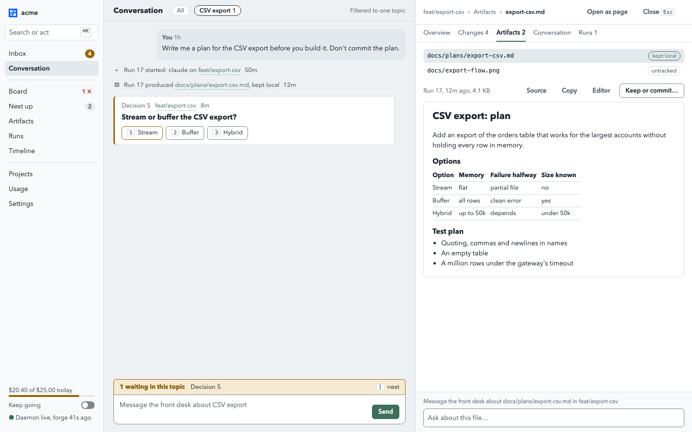

# Artifacts: reading what agents wrote, committed or not

Status: **decided**. The maintainer approved this design on 2026-10-14 with every
recommended default (see [Decided questions](#decided-questions)). Nothing is built yet. It is
the artifact part of the [web UI overhaul](web-ui-overhaul.md) and uses its inspector.

Progress (2026-10-14): A1 is built and merged (`internal/fold/artifacts.go`,
`internal/api/lane_artifacts.go`); A2 to A6 are not started. The ordered list, with the
web viewer first on the lane page (N6) and the Go items running in parallel (N23, N24, N26),
is in [web-ui-overhaul.md](web-ui-overhaul.md#status-and-remaining-work).

## The problem

The person often asks an agent for a plan, a design note or a report, and reads it in a
browser rather than an IDE. Today Shepherd has no idea such a file exists:

- **Nothing names it.** The worker's `report` tool takes a status and free text
  (`internal/cli/mcp.go`, `Runner.Record`); `ask_human` takes a question and options. A
  file an agent wrote is at best a path inside that text, which the web shows as plain
  text.
- **It is only visible by accident.** The lane's Changes tab (`GET /v1/lanes/{id}/diff`,
  `internal/fold/diff.go`) lists untracked files and shows the first 64 KiB of one as
  plain text, below the commits. A markdown plan is shown as source, with no rendering,
  and only while the lane is open.
- **It blocks or dies at close.** Fold's close checks `git status --porcelain`, which
  counts an untracked file as dirty. A manual close refuses and suggests `--force`, which
  deletes the file with the worktree (`internal/fold/fold.go:372`). The automatic close of
  a merged lane refuses too (`fold.go:455`), so a lane whose agent left an uncommitted
  plan stays open after its merge request merged, and the person may not know why.
- **The person often does not want it committed.** A plan for a feature is scaffolding;
  committing it pollutes the repo, and a public repo would publish it. But they still
  want to read it, keep it for a while, and point the desk at it.

## What an artifact is

A file in a lane that the person may want to read, whatever its git state: a plan, a
design note, a report, a diagram, a screenshot. It belongs to a lane, was first produced
by a run, may be tied to decisions and a topic, and has an **intent**: to be committed,
to be kept by Shepherd only, or scratch.

It is not a build output, a log (runs already have one), or a replacement for the diff:
code changes stay in Changes. A committed markdown file in the lane's diff is also listed
as an artifact, so it can be read rendered, but its source of truth is the commit.

## Decisions

Decided by the maintainer on 2026-10-14, as recommended.

| # | Choice | Options | Decided |
|---|---|---|---|
| 1 | How artifacts are found | declared by the agent / discovered in the worktree / both | Both. Declared is exact; discovery covers agents that forget and works for every CLI |
| 2 | Where a file not meant for the repo lives | anywhere in the worktree / a Shepherd directory inside the worktree, excluded from git / outside the worktree | `.shepherd/artifacts/` inside the worktree, excluded through the repo's `info/exclude`. Every agent CLI can write inside its worktree; outside needs per-CLI permission flags |
| 3 | What survives a lane's close | nothing / everything / artifacts, snapshotted | Artifacts, snapshotted into Shepherd's home before the worktree goes |
| 4 | Who decides commit or not | the agent / the person / the agent proposes, the person overrides | The agent declares an intent; the person can change it with a click; undecided files are asked about only at close |
| 5 | Who can commit an artifact | Shepherd itself / the lane's agent | The lane's agent, continued by the desk on the person's word. Shepherd does not author commits |
| 6 | How it renders | as source / rendered in the browser | Markdown rendered with the web's one renderer; code as text with line numbers; images inline. HTML is always shown as source |

## 1. Finding artifacts

Three sources, merged into one list per lane.

| Source | How | Attributed to |
|---|---|---|
| **Declared** | the worker tool `artifact` (`shepherd worker artifact PATH [--title T] [--intent commit\|keep\|scratch]`, mapped onto MCP per `internal/cli/mcp.go`'s rule: command first) and an optional `artifacts` list on `ask_human` | the declaring run (`SHEPHERD_RUN`) |
| **Discovered** | at the end of every run, Shepherd lists the worktree's untracked and modified files (the same git reads as `Fold.Diff`) and keeps those matching the repo's artifact globs, plus everything under `.shepherd/artifacts/` | the run whose end first saw that content (by sha-256) |
| **Committed** | files in the lane's committed range that match the globs | the run that committed them (the diff already knows the range per run) |

Default globs: markdown (`**/*.md`, `**/*.markdown`), images (`**/*.png`, `**/*.jpg`,
`**/*.gif`, `**/*.webp`, `**/*.svg`) and `.shepherd/artifacts/**`. A repo can replace
them in its profile:

```yaml
artifacts:
  discover: ["docs/plans/**", "**/*.md", ".shepherd/artifacts/**"]
  keep_days: 30
```

Git-ignored files are never discovered (except the Shepherd directory, which is ignored
on purpose), so build outputs and dependencies stay out.

**References.** A path in a decision, report or desk message that matches an artifact
of the same lane becomes a link in the web, by lookup at render time. Nothing is stored
for it.

## 2. Keeping it out of the repo when asked

Agents told to keep a file out of the repo write it under `.shepherd/artifacts/` in their
worktree. Shepherd adds one line, `/.shepherd/artifacts/`, to the repo's
`info/exclude` (in the git common directory, so it covers every worktree of the repo,
and is never committed or pushed). The brief tells agents about the directory and the
tool in one sentence. Then:

- the file is never shown as untracked, never makes the worktree dirty, and is never
  committed by accident;
- Fold's close is unaffected by it;
- it is still in the worktree, so "open in editor" works while the lane is open.

Writing to `info/exclude` changes the person's repository configuration, if only
locally; Shepherd does it once per repo, says so in the feed and in `shepherd repo add`,
and the person can refuse it (decided question 2). Whether `git worktree remove` without
`--force` accepts a worktree that holds ignored files is to be confirmed by a test in A4;
if it does not, close removes the directory itself after the snapshot.

## 3. Commit or not

Every artifact has an intent, shown as a badge and changeable by the person.

| Intent | Meaning | At close |
|---|---|---|
| **commit** | belongs in the repo | expected to be in a commit; if it is still uncommitted, close asks |
| **keep** | Shepherd keeps it; not for the repo | snapshotted, then removed with the worktree |
| **scratch** | working notes | snapshotted only if pinned; otherwise dropped with the worktree |
| **undecided** | discovered, nobody said | asked at close, never before |

How the choice is made and carried out:

- The agent declares an intent with the tool. A file under `.shepherd/artifacts/` that
  was not declared defaults to **keep**; any other discovered file to **undecided**.
- The person changes it with "Keep, commit or discard…" in the viewer. That is a web-only
  call (the person's click), like approving a merge request.
- **Commit** on an uncommitted file does not make Shepherd commit. It sends a desk turn
  through the inspector's context composer ("Commit docs/plans/export-csv.md in
  feat/export-csv"), and the desk continues the lane's agent, which commits it in scope
  and under the repo's gate. No new authority, and agents still never approve their own
  work.
- **Move to keep** on an untracked file outside the Shepherd directory moves it there,
  inside the same worktree, so it stops counting as dirty. It is a file move on the
  person's click, in a lane they own; the feed records it.
- **Discard** deletes the file from the worktree and its snapshots after a confirmation
  dialog. It is the person's, and it is destructive, so it is never offered to the desk
  or an agent.

## 4. Lifecycle

```
written by a run ──► live (in the worktree, read on demand)
                       │  run ends: new content seen ──► version recorded, snapshot taken
                       ▼
                  lane closes ──► snapshot of every artifact not already current
                       │
          ┌────────────┼──────────────┐
       committed      kept          scratch / discarded
   (read from git   (read from      (gone unless pinned)
    while the        Shepherd's
    branch exists)   snapshot)
                       │
                  retention: keep_days after close, unless pinned; a size cap evicts oldest first
```

- **Snapshots** are content-addressed files under `~/.shepherd/artifacts/<id>/<sha256>`,
  taken when an artifact is declared, when a run end sees new content, and before any
  close (manual, merged, retire). Text is passed through `internal/redact` before it is
  stored or shown, like every other agent output.
- **Versions.** Each distinct content is a version with the run that produced it, so the
  viewer can show "changed by run 19" and a diff between versions of a text file.
- **Close.** Before closing, the daemon snapshots; then Fold closes as today. If the only
  dirt is artifacts, the close dialog lists them with a choice each (keep, ask the agent
  to commit, discard) instead of the bare `--force` advice. For the automatic close of a
  merged lane, files under `.shepherd/artifacts/` never block; any other undecided file
  keeps the lane open and puts "lane merged, 1 file to keep or discard" in the Inbox
  (decided question 3).
- **Retention.** Snapshots of a closed lane are kept for `keep_days` (default 30), pinned
  ones for ever, under a total cap (default 500 MB) that evicts the oldest unpinned first.
  `shepherd artifact gc` and the daemon's daily timer apply it.

## 5. Data model

Appended migrations in `internal/store`, as the repo requires.

| Table | Columns |
|---|---|
| `artifacts` | `id`, `workspace_id`, `repo_id`, `lane_id`, `run_id` (first producer), `path` (worktree-relative), `title`, `kind` (markdown, text, code, image, other), `source` (declared, discovered, committed), `intent` (commit, keep, scratch, undecided), `state` (live, kept, committed, discarded, gone), `sha256`, `size`, `pinned`, `created`, `updated`, `closed`; unique (`lane_id`, `path`) |
| `artifact_versions` | `artifact_id`, `sha256`, `size`, `run_id`, `seen`, `snapshotted`; unique (`artifact_id`, `sha256`) |
| `artifact_links` | `artifact_id`, `kind` (decision, request, report), `ref`, `created`; unique (`artifact_id`, `kind`, `ref`) |

Topics link artifacts with a new `TopicLink` kind, `artifact`. An artifact with no link of
its own takes its lane's topic when read, the rule topics already use for lanes
([topics.md](../topics.md)). Decisions reach their artifacts through `artifact_links`;
a decision's view gains an `artifacts` list.

## 6. API

Registered in `internal/daemon` like every route, with the existing access flags.

| Route | Who | What |
|---|---|---|
| `GET /v1/artifacts?workspace_id=&lane_id=&run_id=&topic_id=&decision_id=&state=&kind=&since=` | desk, web | the list, newest first |
| `GET /v1/lanes/{id}/artifacts` | desk, web | discovery now (as `diff` reads now), merged with the stored list |
| `GET /v1/artifacts/{id}` | desk, web | one artifact with its versions and links |
| `GET /v1/artifacts/{id}/content?version=` | desk, web | the bytes: live from the worktree, else from the snapshot |
| `POST /v1/runs/{id}/artifacts` | worker, own run | declare `{path, title, intent}` |
| `PATCH /v1/artifacts/{id}` | web only | the person's `intent`, `pinned`, `title`; `move: keep` moves it into the Shepherd directory |
| `POST /v1/artifacts/{id}/discard` | web only | delete from the worktree and the snapshots |

Serving content safely:

- Paths are worktree-relative; `..`, absolute paths and symlinks are refused, as the diff's
  untracked read already does (`untrackedStart`).
- Caps: text up to 1 MiB, images up to 10 MiB; a larger file is listed with its size and
  "open in editor".
- Text of every kind, including `.html` and `.svg` source, is served as
  `text/plain; charset=utf-8`; raster images with their own type; SVG only for an ``
  as `image/svg+xml`, which runs no script there. Every answer carries
  `X-Content-Type-Options: nosniff`, `Content-Security-Policy: sandbox; default-src 'none'`
  and `Content-Disposition: inline`.
- Text is redacted. Images cannot be, so a discovered image is listed but not
  snapshotted unless declared or pinned (decided question 6).

CLI, as clients of the API: `shepherd artifact list|show|cat|pin|gc`, plus the worker's
`shepherd worker artifact`. Desk tools map onto them: `artifact_list` and
`artifact_read` (read-only, redacted, capped), so the person can say "summarise the plan
in feat/export-csv". The desk gets no discard and no intent change.

## 7. Feed and thread

A new closed feed kind, `artifact`, glyph `▤`: "run 17 produced docs/plans/export-csv.md
(kept local)", once per new artifact and once per changed version at a run's end, with
`Ref` the artifact id. In the thread it is a compact row whose path opens the viewer;
under the overhaul's grouping it folds with the run's end.

## 8. The web UI



| Where | What shows |
|---|---|
| Lane inspector, **Artifacts** tab (with a count) | the lane's artifacts: path, intent badge, run, age; the selected one rendered below |
| Run inspector, **Produced** | what the run declared or first produced |
| Decision card and inspector | file chips for its linked artifacts; a chip opens the viewer in the inspector, beside the decision being answered |
| Thread | `artifact` feed rows; paths in messages that match an artifact become links |
| Topic inspector | every artifact in the topic |
| **Artifacts** page (`#/artifacts`) | recent artifacts across lanes, open and closed, filtered by repo, lane, kind, intent, topic; kept snapshots of closed lanes live here |
| Close dialog | the lane's uncommitted artifacts, each with keep, ask to commit, discard |

The viewer:

- Markdown through the one renderer (the overhaul's W0.4: headings, lists, tables,
  blockquotes, code, links), with an outline for long documents. Relative links to other
  artifacts of the lane open them in place; relative images load only if they are
  artifacts too. Nothing is rendered as HTML.
- Code and text: monospace with line numbers, wrapped or not, no highlighter in the first
  version (no new dependency).
- Images: inline, fit to width, click for full size.
- A bar with the run and age, Source, Copy, Download, Open in editor (the existing editor
  link, while the lane is open), and "Keep, commit or discard…".
- Versions: a list with the run of each, and a diff between two text versions.
- "Changed since you read it" marks an artifact whose newest version the person has not
  opened, kept in the browser like the thread's seen state.
- The inspector's context composer reads "Message the front desk about
  docs/plans/export-csv.md in feat/export-csv".

## 9. Build order

Each item is one merge request. Web items need the overhaul's inspector items; Go items
wait for `feat/keep-going-web-feed` to merge, since it holds `internal/api`,
`internal/daemon` and `internal/store`.

| Id | Item | Scope | Depends on |
|---|---|---|---|
| A1 | Read-only discovery: `GET /v1/lanes/{id}/artifacts` from the diff's untracked, uncommitted and committed lists filtered by globs; `content` for a live file with the caps and headers above; `artifacts.discover` in the repo profile. No store change | `internal/fold/**`, `internal/api/**`, `internal/daemon/**`, `internal/config/**` | keep-going lane |
| A2 | The viewer in the lane inspector's Artifacts tab; path links in decisions and messages | `web/src/artifacts/**`, `web/src/inspector/artifact*`, `web/src/inspector/lane*`, `web/src/api/**` | A1, W2.4, W0.4 |
| A3 | Store and declaration: migrations, `shepherd worker artifact` and the worker tool, `ask_human`'s `artifacts`, the run-end scan with attribution, the `artifact` feed kind, the topic link kind, the brief sentence | `internal/store/**`, `internal/cli/**`, `internal/dispatch/**`, `internal/api/**`, `internal/daemon/**` | A1 |
| A4 | Snapshots and close: snapshot on declare, run end and close; the `info/exclude` line; close and merged-close behaviour; move-to-keep and discard; retention and `shepherd artifact gc` | `internal/fold/**`, `internal/daemon/**`, `internal/store/**`, `internal/cli/**`, `internal/git/**` | A3 |
| A5 | The rest of the web: the Artifacts page, Produced on runs, the close dialog's choices, topic and decision links, versions and the version diff | `web/src/pages/Artifacts*`, `web/src/artifacts/**`, `web/src/inspector/**`, `web/src/components/LaneClose*`, `web/src/router*` | A2, A4 |
| A6 | Desk tools `artifact_list` and `artifact_read`, and a line in `DeskBrief` | `internal/cli/**`, `internal/chat/**`, `internal/desk/**` | A3 |

A1 and A2 alone answer the person's first ask (read the plan an agent wrote, rendered,
inside Shepherd) with no migration. A3 and A4 make it reliable and keep files past close.

## Risks

| Risk | Mitigation |
|---|---|
| Secrets in an agent's file reach the browser or the snapshot store | text is redacted like all agent output; images are snapshotted only when declared or pinned; the store sits in Shepherd's home with its permissions |
| Disk growth from snapshots | content addressing, caps per file, `keep_days`, a total cap, `gc` |
| Discovery is noisy in a repo full of markdown | per-repo globs; only untracked, modified and in-range files are considered, never the whole tree |
| A served file runs script in the app's origin | text is never served as HTML; strict headers and a sandbox CSP on every content answer; SVG only as an image |
| Writing `info/exclude` surprises the person | once per repo, announced, refusable, and the alternative (outside the worktree) was weighed in decided question 2 |
| Automatic close behaves differently with artifacts | only files the agent put in the Shepherd directory are ignored; everything else still holds the lane open and asks |
| Attribution by "first seen at run end" is wrong when the person edits a file by hand | the version shows the run, and a version with no running agent is marked "changed outside a run" |

## Decided questions

Decided by the maintainer on 2026-10-14: every question takes its recommended default.
The numbers are stable.

1. **Declared, discovered or both?** **Decided: both.** Discovery alone misses intent;
   declaration alone misses agents that forget.
2. **Where do files not meant for the repo live?** **Decided: `.shepherd/artifacts/` in
   the worktree, excluded through `info/exclude`.** The alternative, a directory under
   `~/.shepherd` handed to the agent, needs each CLI's permission to write outside its
   worktree (Claude Code's `--add-dir` and the others' equivalents).
3. **A merged lane with an undecided uncommitted file: close it or ask?** **Decided: ask,
   in the Inbox; files in the Shepherd directory never block.**
4. **Retention.** **Decided: 30 days after close, pinned for ever, 500 MB in total.**
5. **Default discovery globs.** **Decided: markdown and images anywhere, plus the
   Shepherd directory; replaceable per repo.**
6. **Discovered images, which cannot be redacted: snapshot them?** **Decided: no, unless
   declared or pinned; they are still viewable while the lane is open.**
7. **Should the front desk be able to produce artifacts?** It has no worktree. **Decided:
   not in this design; its answers stay in the thread.**
8. **Should "commit" ever be done by Shepherd rather than the lane's agent?** **Decided:
   no; Shepherd does not author commits, and the agent commits under the repo's gate.**
