# Web UI fidelity audit against the mockup

Status: **audit**, read-only. No code changed. It answers one question from the maintainer:
the web UI on `dev` "is not as tight as" the approved
[mockup](web-ui-overhaul/mockup.html), where exactly and by how much. The plan it measures
against is [web-ui-overhaul.md](web-ui-overhaul.md); this note changes none of its decisions.

## Short answer

The tokens are close. The colours are within a few RGB steps of the mockup, the radii within
half a pixel, and the family is the same IBM Plex. What differs is **structure and scale**:

1. The real conversation page keeps the old Chat layout (its own "Chat" heading, a backlog
   rail, a topic bar, a pending list) inside the new shell, so the thread is **488 px wide
   against the mockup's 648 px**, and the page head costs **137 px (41 + 96) against 45**.
2. The inspector is **403 px wide against 576**, as tall as its content (627 px of 900)
   rather than the full column, and has a title chip where the mockup has a breadcrumb row.
3. Everything is built on a **15 px root** (a fluid clamp) where the mockup is a flat **14 px**
   body with pixel values, so every `rem` value is about 7% larger, and page titles are 22.5
   px against 16.
4. Inbox is a different component: two-line stacked rows at 57 px, no selection, no age
   column, no glyph column, filters as underlined links, and no merge request inspector.
5. A handful of plain bugs make the pane look unfinished: a monospace "own answer" box, a
   native-looking context composer, a CSS variable that is not defined, and a grey Send.

Most of the gap is in shared files (`theme.css`, `layout/shell.css`, `inspector.css`,
`chat.css`) that none of the open page lanes owns. The page lanes (Board, Next up, Projects,
Settings, Runs, Artifacts) hold only their own pages, and four of the five largest gaps are
outside all of them.

## How it was measured

- **Build**: `web/` built from this lane's checkout of `dev` (`7d0a9d8`), Vite production
  build, served by `web/shots/stub-daemon.mjs`. That is the repo's own throwaway daemon with
  made-up data (acme-* repos, decisions, a failed pipeline, topics, runs, a quota hold). It
  touches no real daemon and no `~/.shepherd`. Its seed is the mockup's story: decision 5,
  request 3, `!41`, `!42`, CSV export.
- **Browser**: headless Chrome through the DevTools protocol, one viewport per width (1440,
  1100 and 760 by 900), scale 1, light; 1440 also in dark. Reduced motion on.
- **Mockup**: opened from disk at `#conversation`, `#inbox`, `#artifact`. IBM Plex is not
  installed on the measuring machine, so for **computed-style measurements** the mockup got
  the repo's bundled Plex through an injected `@font-face`. That keeps font metrics out of the
  comparison. The screenshots below are of the mockup as it renders, which on this machine
  falls back to the next family in its stack (Avenir Next).
- **Pairs**: computed style and box metrics for 90 element pairs (font size, weight, line
  height, padding, margin, gap, radius, border, colour, shadow, width, height), plus the
  `:root` tokens read from both stylesheets.
- **Not comparable**: the mockup has no Board, Lane, Next up, Runs, Projects, Settings or
  Artifacts page, only the three views, so those pages are judged against the mockup's rules
  (head, rows, chips, buttons), not pixel for pixel. It also defines no breakpoint (see
  [Widths](#widths)).

The real routes used: `#/chat?open=decision:5`, `#/inbox`, `#/chat?open=lane:4/artifacts`,
`#/lanes/4`, `#/board`, `#/next`. There is no `#/artifacts` page on `dev` yet (it is in
`feat/web-artifacts-page`), and `open=mr:41` is not an inspector kind, so the merge request
inspector of the Inbox view cannot be shown at all.

## The two views side by side

| 1440 light, conversation | |
|---|---|
| Mockup |  |
| `dev` | 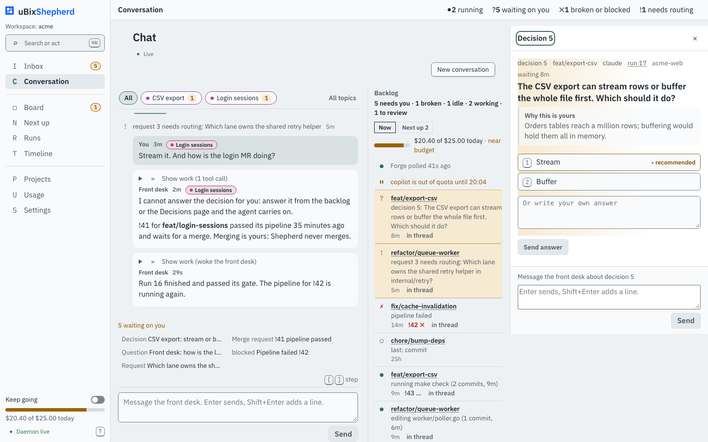 |

| 1440 light, inbox | |
|---|---|
| Mockup | 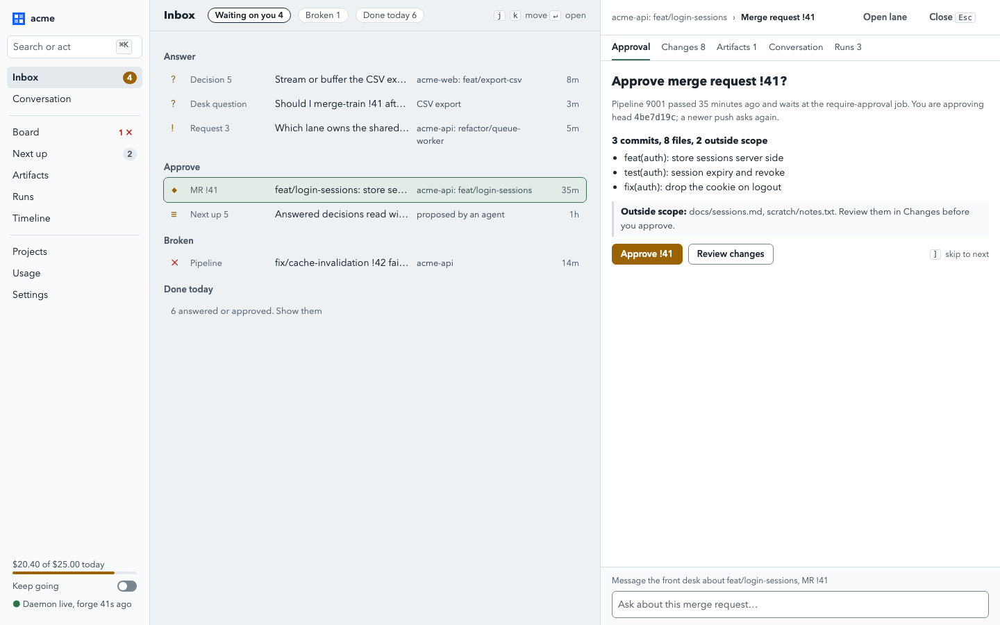 |
| `dev` | 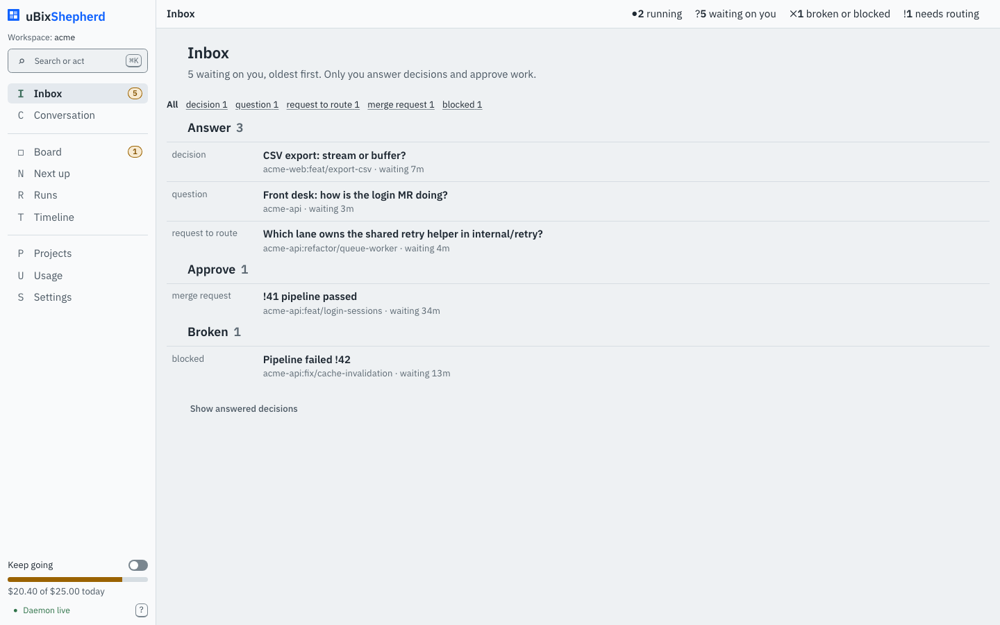 |

| 1440 light, inspector artifacts | |
|---|---|
| Mockup |  |
| `dev` (the lane inspector's Artifacts tab, the only artifact surface on `dev`) | 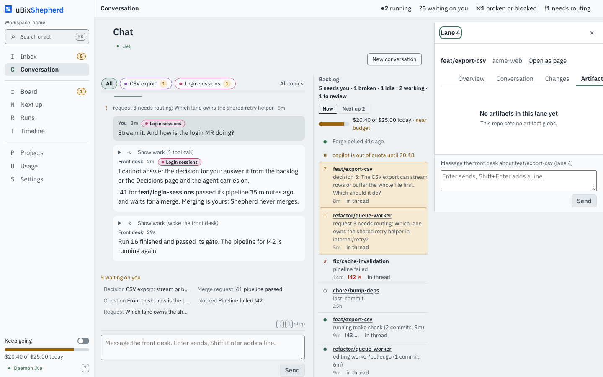 |

Pages with no mockup counterpart, for the shared rules only:

| Lane | Board | Next up |
|---|---|---|
| 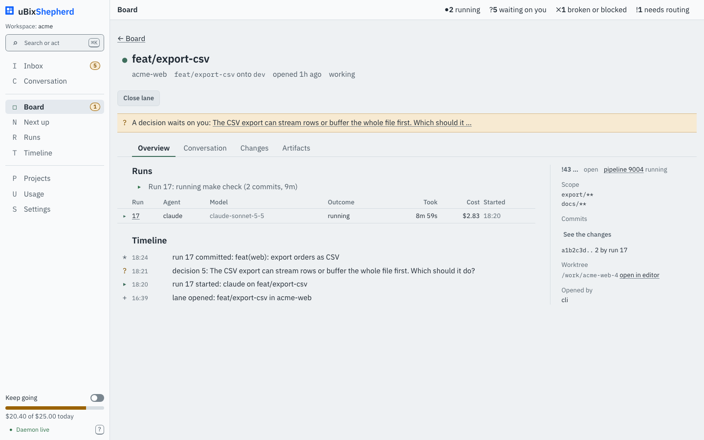 | 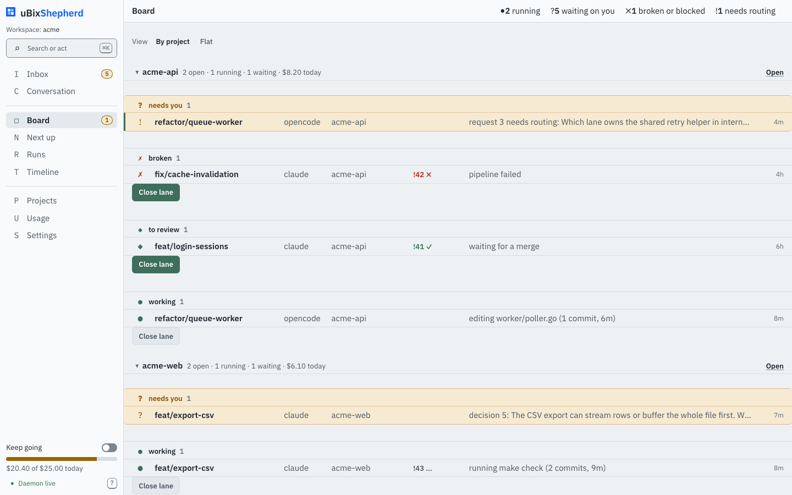 | 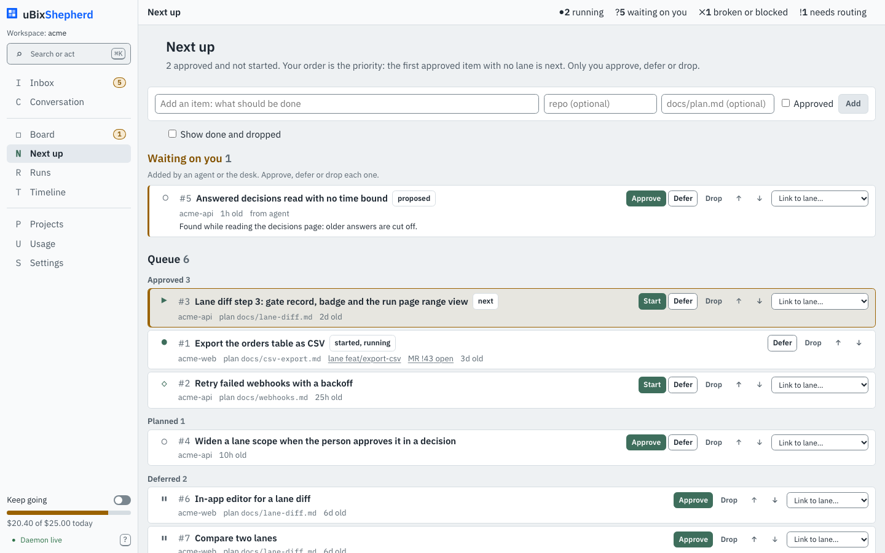 |

## Layout at the three widths

All values in CSS pixels, from `getBoundingClientRect`.

| Width | Region | Mockup | `dev` | Gap |
|---|---|---|---|---|
| 1440 | sidebar | 216 | 225 | +9 |
| 1440 | centre column (page) | 648 | 812 | wider, but see next row |
| 1440 | the thread itself | 648 | 488 | **-160 (-25%)** |
| 1440 | backlog rail inside the page | none | 274 | not in the mockup |
| 1440 | inspector width | 576 | 403 | **-173 (-30%)** |
| 1440 | inspector height | 900 (full column) | 627 (content) | **-273** |
| 1440 | page head (bar + page head) | 45 | 41 + 96 = 137 | **+92** |
| 1100 | sidebar | 216, full | 53, icons | by design (collapse at 1280) |
| 1100 | inspector | 576, split, crushes the centre to 308 | 420 overlay with scrim | see [Widths](#widths) |
| 760 | layout | overflows: centre 0 wide, inspector on top of the sidebar | 53 sidebar, 420 overlay | mockup undefined |

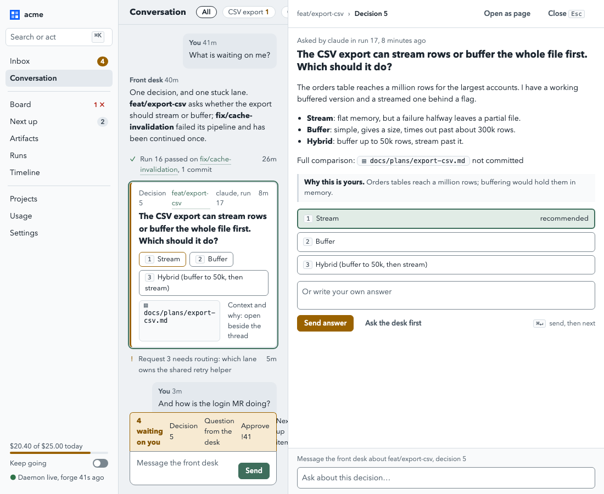
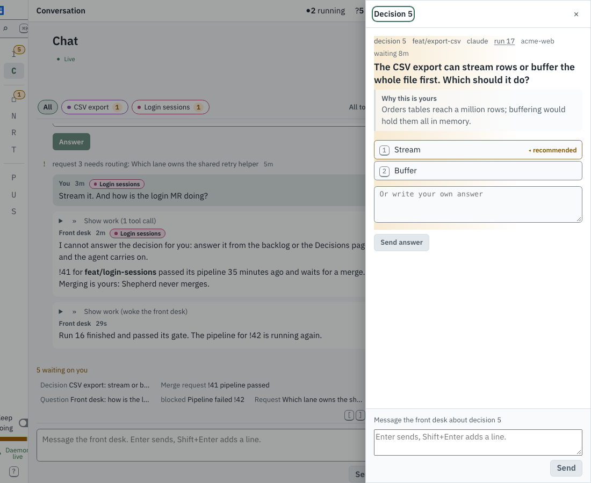

## Ranked gap list

Ranked by how much of the screen the difference changes, biggest first. "Mockup vs `dev`" is
a measured value unless marked. "Lane" is the open lane that would hold the fix, or "shell /
theme" where no open lane's scope contains the file (it needs its own lane). Scopes are from
the plan's N-table and, for the lanes with commits, from what the branch changes.

### 1. The conversation page carries the old Chat layout

| | Mockup | `dev` |
|---|---|---|
| Heading | one 45 px row: `h1` 16 px / 700 and the topic chips inline, status at the right | a 41 px page bar ("Conversation", 15 / 600) **and** a 96 px page head with `h1` "Chat" 22.5 / 600, a "Live" line and a "New conversation" button |
| Thread width at 1440 | 648 | 488 (a 274 px backlog rail sits in the page, a 20 px gutter, then the thread) |
| Topic chips | 22.8 px high, 12 px radius, 1 px `--rule`, selected: 1 px `--ink`, 600 | 27 px high, 999 px radius, a hue per topic (purple, rose), a count badge, selected: lichen wash and lichen border |
| Pending list | one 32.5 px lantern-wash band joined to the composer (6 / 12 padding, `r r 0 0`, 1 px lantern), chips are plain text | no band, no wash; wraps to 3 rows, 138 px; chips 999 px pills, `border: 1px solid var(--line)`, where `--line` is not a token (see gap 11), so the border is dropped |
| Composer | 62 px: textarea and **Send** inline, `r-lg` bottom corners | 124 px: bordered textarea 61.5 px, Send beneath, no joining |
| Backlog rail | none; the Inbox is where waiting work lives | Backlog with spend, forge, quota, 7 rows, a "Now / Next up" switch |

Owner: `web/src/pages/Chat.tsx`, `web/src/chat/**`, `web/src/styles/chat.css`,
`web/src/components/Backlog.tsx`, `TopicBar.tsx`, `web/src/styles/layout/page.css`.
Lane: **shell / theme, needs its own lane** (the thread and chat lane N14 of the plan; none is
open). `fix/conversation-reply-row` is scoped to one row in the thread and should not take it.
Decision needed first: the plan keeps the backlog rail until the Inbox replaces it, so the
rail may be a decided difference, not a gap. Say so before fixing.

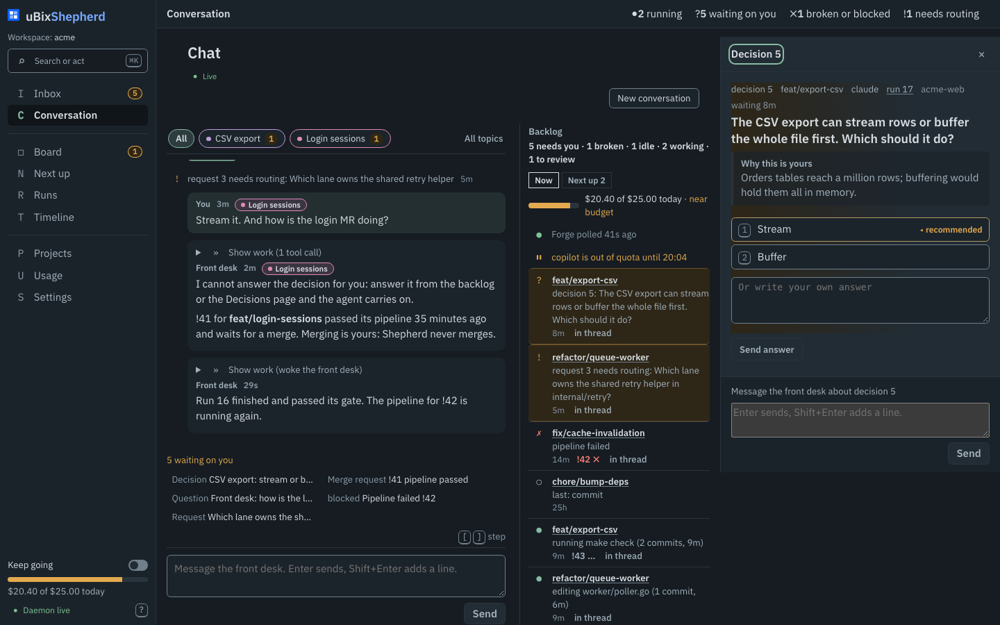

### 2. The inspector: width, height and head

| | Mockup | `dev` |
|---|---|---|
| Width at 1440 | `minmax(26rem, 36rem)` = 576 | `clamp(24rem, 28vw, 34rem)` = 403 |
| Height | the full column, 900 | `align-self: flex-start; max-height: 100vh` so it ends with its content: 627 on a decision, 505 on a lane with nothing to show |
| Head | breadcrumb row: `lane › Decision 5`, "Open as page" and "Close Esc" as ghost buttons, 12.5 px, 50 px tall | a title chip `Decision 5` (`h2`, capitalised, 15 / 700) with a `:focus-visible` outline left on it after opening, and a bare `×` |
| Tabs | 13 px, 16 px gap, no padding, 2 px lichen inset underline | none on a decision; on a lane 15 px, 12 px padding, 4 px gap, and the strip clips at 403 px ("Artifact") |
| Body padding | 14 / 16 | 15 / 15 |
| Edge | 1 px rule, no shadow | 1 px rule |

Owner: `web/src/styles/inspector.css`, `web/src/inspector/Inspector.tsx`, `lane.tsx`,
`decisionPane.tsx`. Lane: `feat/web-artifacts-page` holds `web/src/inspector/**` (it adds the
artifact pane and edits `Inspector.tsx`, `runPane.tsx`), so the **CSS** (`inspector.css`) is
free to move but the TSX head is not. Split into two fixes (see the MR set).

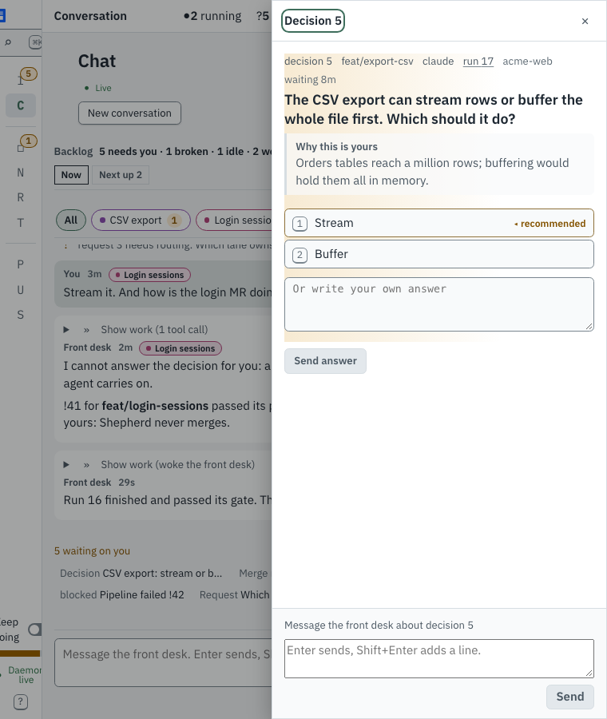

### 3. Inbox is a different component

| | Mockup | `dev` |
|---|---|---|
| Head | one 45 px row: `h1` 16 px, chips "Waiting on you 4 / Broken 1 / Done today 6", key hints at the right | 41 px bar "Inbox" **plus** `h1` "Inbox" 22.5 px and a sentence, 58 px |
| Filter | chips: 1 px rule, 12 px radius, selected 1 px ink | five underlined links, unstyled |
| Group heading | 13 / 600 muted, 12 px above | 17.8 px, ink, indented 30 px, count in grey |
| Row | grid `18px 7rem 1fr 11rem 3rem`, 35 px, 7 / 10 padding, `r` radius, one line | two lines, 56.8 px, 1 px top rule, no radius, title 600 on the first line and meta below |
| Columns | glyph, kind, title, where, age | kind and title only; no glyph, no age column |
| Selection | `--lichen-wash` fill with a 1 px lichen outline; first item opened in the inspector | none; nothing opens until clicked |
| Inspector | merge request approval with tabs Approval, Changes 8, Artifacts 1, Conversation, Runs 3 | `mr` is not in `OPEN_KINDS` (`router.ts:17`): not built |
| Done today | line "6 answered or approved. Show them" | link "Show answered decisions", differently worded |

Owner: `web/src/pages/Inbox.tsx`, `web/src/styles/pages/inbox.css`, `web/src/router.ts`
(the `mr` kind), `web/src/inspector/**` (the approval pane). Lane: **shell / theme, needs its
own lane** (none of the page lanes lists Inbox; `feat/web-inbox` exists on the remote and is
the natural holder if it is still live: confirm with the person).

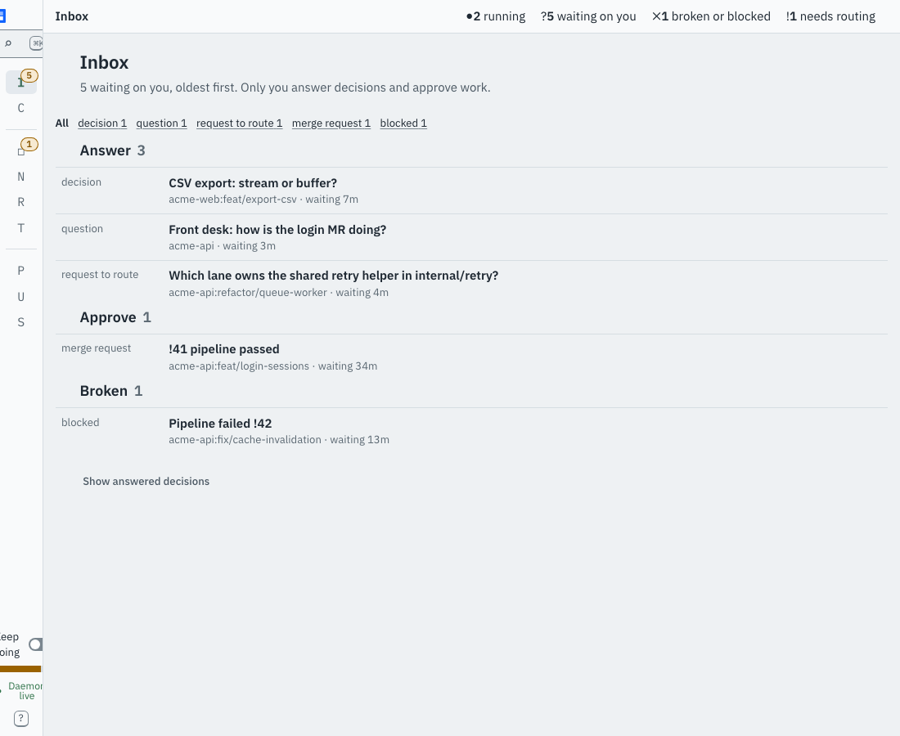

### 4. Scale: root size, type and leading

| | Mockup | `dev` |
|---|---|---|
| Root | 16 px (browser default), all values in px | `clamp(15px, 0.65625rem + 0.3125vw, 18px)`: 15 px at 1440, and 15 px at 1100 and 760 |
| Body | 14 px / 1.5 = 21 px | 15 px / 1.45 = 21.75 px |
| Small text | 13 / 12.5 / 12 / 11.5 / 11 | 13.125 (`--t-xs`) and 12.19 (`--t-2xs`), one step each |
| Page `h1` | 16 px / 700 | 22.5 px / 600, letter-spacing -0.01em (`--t-xl`) |
| Inspector `h2` (the question) | 18 / 700, 1.3 | 15 / 600, 1.35 |
| Card question | 15 / 700 | 15 / 600 (inline), 15 / 600 (pane) |
| Wordmark | 14 / 600 workspace name | 17.8 / 600 product name |
| Group and section heads | 13 / 600 muted | 17.8 / 600 ink |

Weights: the mockup's bold is 700 for headings and 600 for names; `dev` loads 400, 500 and 600
only, so a mockup 700 renders as 600. A 700 face is missing from `public/fonts`, or the
mockup should say 600.

Owner: `web/src/styles/theme.css` (`--root-min`, `--t-*`, `body`). Lane: **shell / theme,
needs its own lane**. The decision is the person's: the clamp is deliberate (it grows on a
large display), so the choice is a smaller `--root-min` (14 px at 1440 matches the mockup) or
a documented rule that the mockup is drawn at 14 px and the app at 15.

### 5. Sidebar

| | Mockup | `dev` |
|---|---|---|
| Width | 216 (13.5rem at 16) | 225 (15rem at 15) |
| Top | mark + "acme" at 14 / 600 (the workspace is the brand) | mark + "uBixShepherd" at 17.8 / 600 in brand blue, then "Workspace: acme" 12.2 px |
| Search | `--raised` fill, 1 px `--rule`, 14 px, `⌘K` in a 3 px-radius chip on `--surface` | `--field` fill, 1 px `--control-border`, 12.2 px, a `⌕` icon column, `⌘K` in a 5.6 px-radius chip |
| Nav item | 31 px, ink, 14 px; selected `--sunk` and 600 | 29.3 px, **muted** (74 87 98), 15 px; a mono letter column ("I C D N R T P U S") |
| Count | solid lantern fill, white text, 12 px, 9 px radius; Board: red "1 ✗" text only | lantern wash with an inset 1 px lantern ring, 11.25 px, 999 radius; Board gets the same wash badge |
| Group separator | 1 px line, 8 px margin | 1 px line plus 11.25 px of padding |
| Meter | 4 px, 2 px radius | 7.5 px, 5.6 px radius |
| Footer text | 12.5 px; "Daemon live, forge 41s ago" | 13.1 px; "Daemon live" and a `?` help button |
| Nav entries | adds **Artifacts** between Next up and Runs | no Artifacts entry (in `feat/web-artifacts-page`) |

Owner: `web/src/styles/layout/shell.css`, `web/src/ui/ui.css` (`.ui-badge`),
`web/src/shell/Sidebar.tsx`, `nav.ts` (the Artifacts entry is already in that lane's diff).
Lane: **shell / theme, needs its own lane** for the style; the Artifacts entry comes with
`feat/web-artifacts-page`. Related, not a fidelity gap: the "workspace switcher" is a
read-only label, as the plan already says.

### 6. Decision card and pane

| | Mockup | `dev` |
|---|---|---|
| Thread card | raised card: 1 px rule, **3 px lantern left border**, 6 px radius, 10 / 14 padding; the selected one outlined 2 px lichen | no card: a flat block with a 30% lantern top rule, 7.5 px padding, no background |
| Meta | `Decision 5 · lane · claude, run 17 · 8m` on one line, 12.5 px | `decision 5, lane, claude, run 17, acme-web, waiting 8m` wraps to two lines in the pane |
| Options (thread) | inline chips, 27.5 px, wrap, recommended outlined lantern | stacked full-width rows, 25 px |
| Options (pane) | 37.5 / 35.5 px rows (7 / 10 padding), picked: 2 px lichen border on `--lichen-wash`, "recommended" at the right in faint | 25 px rows (2 / 7.5 padding), recommended: 1 px lantern, inset 3 px bar; "◂ recommended" in bold lantern |
| Why this is yours | `--surface` block, 3 px rule bar, one line: bold lead-in then text, 13 / `--muted` | `--surface` at 70% block, 3 px bar, a heading line then the text, 15 px (larger than the options) |
| Answer button | lantern ("warn"), 13 / 600, 29 px, "Send answer" then ghost "Ask the desk first" and a `⌘↵` hint | `ui-btn-primary` (lichen); shown grey until an option is picked; no ghost button, no hint |
| Own answer | placeholder in Plex 14 px, 52 px, 6 px radius | **UA monospace 13.3 px, black text** (see gap 8) |
| Focused card | none | a `lantern-wash` gradient over the whole pane (`pages/decisions.css:7`) |

Owner: `web/src/styles/decisions.css`, `web/src/styles/pages/decisions.css`,
`web/src/components/DecisionCard.tsx`, `web/src/inspector/decisionPane.tsx`,
`web/src/ui/ui.css`. Lane: **shell / theme, needs its own lane**
(N14 in the plan: "the chat and the decision inspector").

### 7. Thread messages and events

| | Mockup | `dev` |
|---|---|---|
| Your message | bubble that shrinks to the text, right-aligned, `--sunk`, 10 px radius, 8 / 12 padding | full width of the thread (458 px), `--sunk`, 9.4 radius, 10 px vertical margin |
| Desk message | **unboxed** text on the field, 72ch | a card: `--sheet` fill, 9.4 radius, 8 / 12 padding, 207 px for four lines, with a "Show work (n tool call)" fold above |
| Who line | 12.5 px, name bold muted, time regular | 12.2 px, whole line 600, topic pills inline |
| Event row | 13 px, glyph 14 px wide, `gap: 8px`, age 13 px regular | 13.1 px, glyph **30 px wide in mono**, age 12.2 px / 600 |
| Gap between items | 12 px | 2 px + 10 px margins (uneven) |

Owner: `web/src/styles/chat.css`, `web/src/styles/conversation.css`, `web/src/chat/**`.
Lane: **shell / theme, needs its own lane**; `fix/conversation-reply-row` touches the reply
row only. Same lane as gap 1.

### 8. Form controls that are not styled

| Element | Mockup | `dev` | File |
|---|---|---|---|
| "Or write your own answer" | Plex 14 px, `--faint` placeholder, 6 px radius | `font-family: monospace; font-size: 13.33px`, black | `theme.css:198` sets `font: inherit` for `button, input` only; `pages/decisions.css:23` styles `.own textarea` with no `font` |
| Context composer textarea | `--control` 1 px border, 6 px radius, 8 px padding, `--raised` | UA default border `rgb(118 118 118)`, 0 radius, 2 px padding, black | `styles/composer.css:12` sets `font: inherit` only |
| Composer **Send** (the page and the inspector) | lichen fill, white, 13 / 600, 29 px | grey fill (227 232 236), muted text: legacy `.button-primary`, not `ui-btn-primary` | `chat.css`, `controls.css` |
| Send answer | lantern, see gap 6 | lichen, disabled-grey | `decisions.css` |
| `<select>` on Next up | n/a | native select, 11 px | `next.css` |

Fix: add `textarea, select` to the reset in `theme.css`, move the legacy `.button` users onto
`Button`, give the composer textareas one rule. Owner above. Lane: **shell / theme**.

### 9. Lane, Board, Next up against the mockup's rules

No mockup page exists, so these are measured against the shared rules.

| Rule in the mockup | Lane page | Board | Next up |
|---|---|---|---|
| Head: one 45 px row, `h1` 16 / 700 | 22.5 px `h1`, plus a "Board" bar title, a "back" link and 4 sub-lines: 160 px | `board-tools` row, no `h1` | `h1` 22.5 plus a 2-line sentence |
| Tabs: 13 px, 16 px gap, 2 px lichen inset underline | 15 px, 12 px padding, border-bottom 2 px lichen, indented 30 px | n/a | n/a |
| One primary per view, lantern for what waits on the person | one lichen "Close lane" under the head | a "Close lane" button under four rows in one view: two lichen primary, two grey | lichen "Approve" and "Start" buttons on several rows at once |
| Row: 35 px, 7 / 10, `r` radius | runs table with 1 px rules, 30 px indent | row about 32 px; the "needs you" band runs wider than the page gutter | card rows, about 60 px |
| Groups: 13 / 600 muted | `h2` 17.8 px | 12.2 px, lantern for "needs you" | 17.8 px, ink |

Owner and lane:

| Page | Files | Lane |
|---|---|---|
| Board | `web/src/pages/Board.tsx`, `styles/layout/rows.css`, `styles/pages/board.css` | `feat/web-page-board` |
| Next up | `web/src/pages/Next*`, `styles/next.css`, `styles/pages/next.css` | `feat/web-page-next-up` (on `dev` as of `7d0a9d8`; the polish is a follow-up) |
| Lane page | `web/src/pages/Lane.tsx`, `styles/pages/lane.css`, `styles/conversation.css` | **shell / theme, needs its own lane** (N16 merged) |
| Projects | `pages/Project*`, `styles/projects.css` | `feat/web-page-projects` |
| Settings, Usage | `pages/Settings*`, `Usage*`, `styles/settings.css`, `usage.css` | `feat/web-page-settings` |
| Runs, Timeline | `pages/Runs*`, `Timeline*`, `web/src/timeline/**` | `feat/web-page-runs` |
| Artifacts page | `pages/Artifacts*`, `web/src/artifacts/**` | `feat/web-artifacts-page` |

### 10. Tokens

Light values (the dark set follows). `dev` is `theme.css`; "mockup" is the mockup's `:root`.

| Token | Mockup | `dev` | Note |
|---|---|---|---|
| `--field` | `#eef1f4` | `#eef1f3` (`--kit-field` is `#eef1f4`) | the body uses `--field`; the "planned page colour" never moved |
| `--surface` | `#f9fafb` | `#f9fafb` | same |
| `--raised` | `#ffffff` | `#ffffff` | same |
| `--sunk` | `#e4e9ee` | `#e4e9ee` | same |
| `--ink` | `#1c2630` | `#1e2832` | 2 steps |
| `--muted` | `#4a5763` | `#4a5762` | 1 step |
| `--faint` | `#5d6a75` | `#5b6872` | 2 steps, darker (more contrast) |
| `--rule` | `#d5dce2` | `#d6dde2` | 1 step |
| `--control` | `#7a868f` | `#7a868f` (`--control-border`) | renamed, same value |
| `--lichen` | `#3e6e5c` | `#3e6e5c` | same |
| `--lichen-wash` | `#e1ece6` | **missing** | the mockup's selected rows and picked options need it |
| `--lantern`, `--lantern-ink`, `--lantern-wash` | `#9a6200 #845300 #f7ead2` | same | same |
| `--broken`, `--ok`, `--brand` | `#b42318 #2f7349 #0f62fe` | same | same |
| `--r`, `--r-lg` | 6 px, 10 px | 0.375rem = 5.6 px, 0.625rem = 9.4 px | scale effect of the 15 px root |
| `--font` | Plex, Avenir Next, Segoe UI | same family first | same |
| `--line` | n/a | **used, not defined** (`chat.css:134`) | the pending chips have no border colour |

| Dark token | Mockup | `dev` |
|---|---|---|
| `--field` | `#151b21` | `#161c22` (`--kit-field` `#151b21`) |
| `--ink` | `#e3e8ec` | `#d6dce1` |
| `--muted` | `#b3bec7` | `#a3b2bd` |
| `--faint` | `#9aa7b1` | `#8a9aa7` |
| `--rule` | `#2f3b45` | `#2a343d` |
| `--control` | `#6f7d88` | `#6f7f8b` |
| `--lichen` | `#7fbfa4` | `#86bba2` |
| `--lantern` | `#e0a43a` | `#e3aa4f` |
| `--lantern-ink` | `#f0b85a` | `#e3aa4f` |
| `--lantern-wash` | `#33281a` | `#2e2617` |
| `--lichen-wash` | `#1f3029` | missing |
| `--broken` | `#f2867a` | `#f07d70` |
| `--ok` | `#79c08e` | `#7cc492` |

The dark gap is larger than the light one: `--ink` is 13 steps darker in `dev` (text on the
night field is dimmer) and the mockup's `--lantern-ink` is a lighter step than `--lantern`,
which `dev` collapses into one value. Both are single-file changes in `theme.css`.

Owner: `web/src/styles/theme.css`. Lane: **shell / theme, needs its own lane**.

### 11. Small defects found on the way

| Where | What |
|---|---|
| `chat.css:134` | `border: 1px solid var(--line)`: `--line` is not defined anywhere, so the declaration is invalid and the chip has no border (only the `aria-current` one gets its lantern border) |
| `theme.css:198` | the `font: inherit` reset skips `textarea` and `select` |
| `inspector.css:43` | focus moves to the inspector `h2` on open (intended, for keyboards), and the ring shows after a mouse open too, so the title looks like a pill; `:focus-visible` should not match there, or the ring should be quieter |
| `StatusCounts` in the page bar | four counts, not in the mockup (added by plan item N1); it duplicates what the sidebar badges and the "5 waiting on you" list already say |
| Sidebar "Board 1" | a lantern badge, where the mockup shows broken work as red text, so the Board count reads as "waiting" |
| Inbox and chat | the same page title twice (bar and `h1`) |

## Widths

The mockup is a 1440 drawing. At **1100** its three columns keep 216 + 576 + the rest, so
the centre is 308 px and the pending strip and cards overflow; at **760** the centre column
is 0 px wide and the inspector sits on the sidebar. It is not a reference below about 1280.
The real UI collapses the sidebar to icons below 1280, overlays the inspector below 1440 and
sheets it below 760, which is what the plan decided. So at 1100 and 760 the gap list above
holds (type, tokens, head, rows), and the layout differences are **by design**, not to be
"fixed" towards the mockup. One thing worth a decision: at 1100 the inspector is a modal
overlay with a scrim over the thread, so the thread cannot be read while answering; the plan
says "drawer", which is what it is, but at 1100 there is room for a split of 24rem.

## Proposed fix merge requests

Grouped so no two MRs share a file. "After" lists a real dependency (a file or lane).

| # | MR (Conventional Commit) | Gaps | Files (scope) | Lane / after |
|---|---|---|---|---|
| F1 | `fix(web): tokens, type scale and form-control reset` | 4, 8, 10, 11 | `web/src/styles/theme.css`, `web/src/styles/composer.css`, `web/src/styles/chat.css` (the `--line` line only) | own lane; **first**, every other MR reads these values. Needs the person's choice on the root size |
| F2 | `fix(web): sidebar to the mockup` | 5 | `web/src/styles/layout/shell.css`, `web/src/shell/Sidebar.tsx`, `web/src/ui/ui.css` (`.ui-badge` only) | own lane; after F1. The Artifacts entry waits for `feat/web-artifacts-page` |
| F3 | `fix(web): inspector frame width, height and head` | 2 | `web/src/styles/inspector.css`, `web/src/inspector/Inspector.tsx` head markup | own lane; after F1 and **after `feat/web-artifacts-page` merges** (it edits `Inspector.tsx`) |
| F4 | `fix(web): decision card and pane` | 6, 8 | `web/src/styles/decisions.css`, `web/src/styles/pages/decisions.css`, `web/src/components/DecisionCard.tsx`, `web/src/inspector/decisionPane.tsx` | own lane; after F1 and F3; `fix/conversation-reply-row` touches `DecisionCard`: check |
| F5 | `fix(web): conversation page head, thread and composer` | 1, 7 | `web/src/pages/Chat.tsx`, `web/src/chat/**`, `web/src/styles/chat.css`, `web/src/styles/conversation.css`, `web/src/components/TopicBar.tsx` | own lane; after F1 and `fix/conversation-reply-row`. Backlog rail: decision first |
| F6 | `feat(web): inbox rows, selection and merge request inspector` | 3 | `web/src/pages/Inbox.tsx`, `web/src/styles/pages/inbox.css`, `web/src/router.ts` (`mr` kind), `web/src/inspector/approvalPane.tsx` (new) | own lane (or `feat/web-inbox` if live); after F3 and `feat/web-artifacts-page` (router and inspector) |
| F7 | page polish, one per page | 9 | each page's own files, as in the table in gap 9 | `feat/web-page-board`, `-next-up`, `-projects`, `-settings`, `-runs`, `feat/web-artifacts-page`, after F1; each stays inside its own scope |
| F8 | `fix(web): lane page head and tabs` | 9 | `web/src/pages/Lane.tsx`, `web/src/styles/pages/lane.css` | own lane; after F1 and F3 |

Order: **F1, then F2 and F3 in parallel, then F4, F5, F6, F8**; F7 rides with each page lane.
F1 first because `theme.css` is read by every other file; nothing in F2 to F8 should hard
code a value the F1 token will change.

Decisions the person has to make before F1:

1. **Root size**: keep the 15 px fluid clamp and rescale the mockup, or lower `--root-min` to
   14 px so a 1440 window matches it. Recommendation: 14 px at 1440 (`--root-min: 14px`),
   because every other number in the mockup then matches without per-element edits.
2. **Backlog rail**: keep until Inbox lands (the plan's wording), or retire now (a 25% wider
   thread). Recommendation: keep it, but make the thread the wider side and cap the rail at
   18rem; retire it with F6.
3. **700 weight**: add the Plex Bold file to `public/fonts`, or change the mockup's 700 to
   600. Recommendation: 600; it is what every shipped heading already uses.

## What was not checked

- Dark theme beyond the conversation view (the token table covers the rest).
- Hover and focus states, and the motion (reduced motion was on).
- The terminal chat (`shepherd chat`); only the web UI.
- A real daemon with real data: long titles, many lanes, and error states are not in the
  stub, so truncation and empty states are not covered.
- Pages whose lane is still open were measured as they are on `dev`, not as in their
  branches: Board, Projects, Settings and Runs may already have changed some of gap 9.
