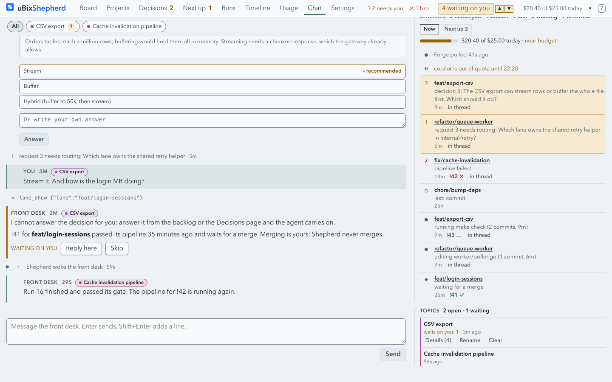
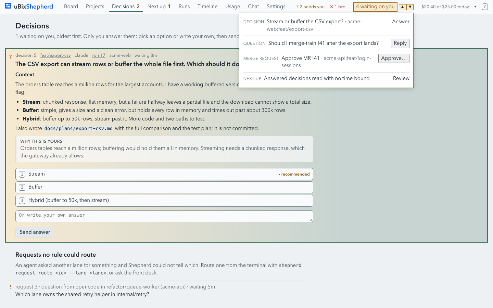
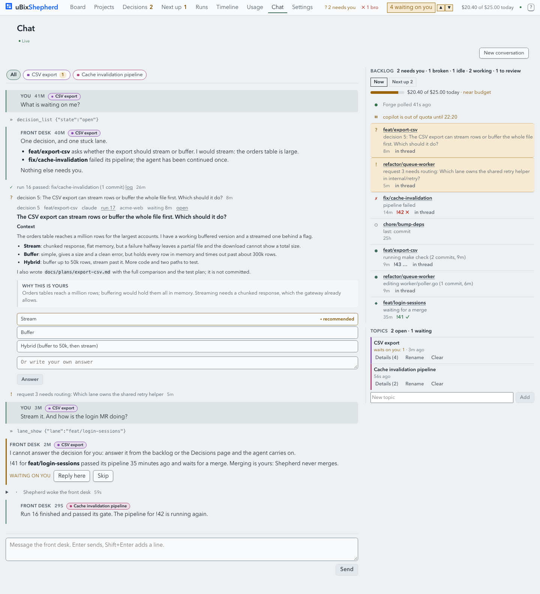
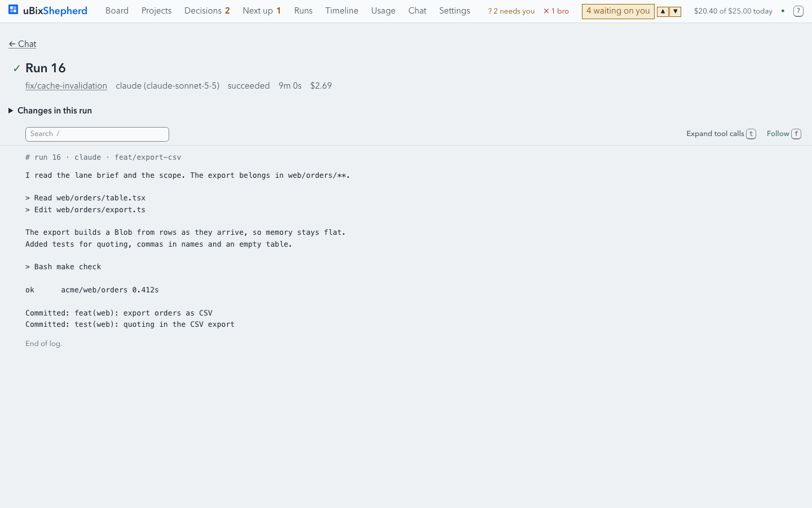
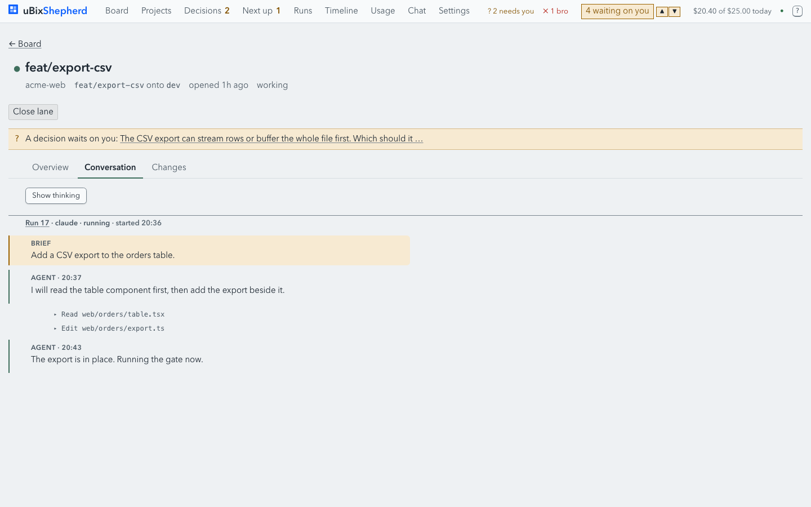
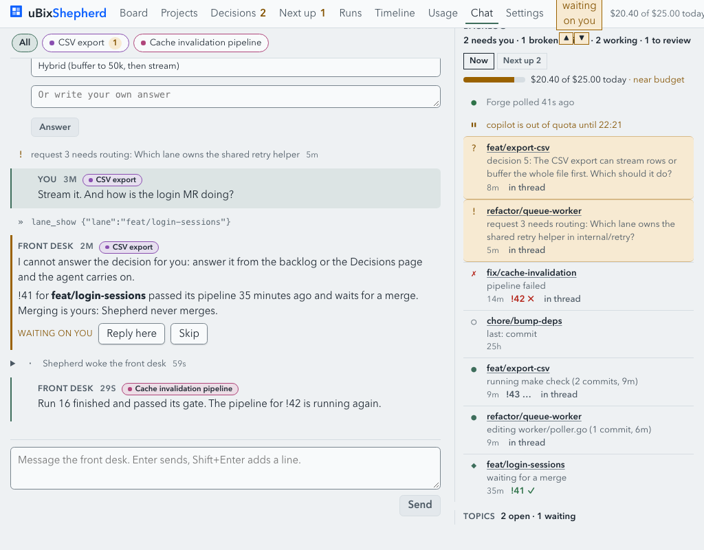
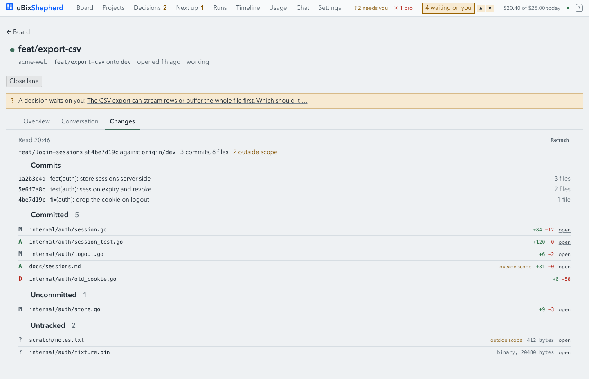
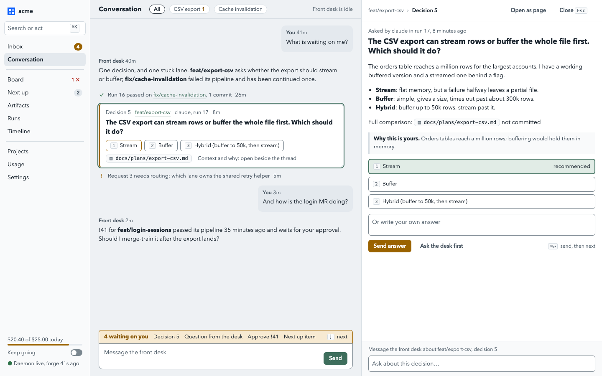

# Web UI overhaul: one conversation, everything opens beside it

Status: **decided**. The maintainer approved the plan and the mockup on 2026-10-14 and took
every recommended default (see [Decided questions](#decided-questions)). Nothing is built
yet; this document changes no code. The artifact feature it refers to has its own design, [artifacts.md](artifacts.md).

The web UI (`web/`) grew one feature at a time: the board, then lanes, runs, decisions,
the chat, topics, Next up, Waiting on you, approvals, the timeline. Each landed as a page
or a widget on a page, and each was right on its own. Used all day, the result is clunky:
everything is a page, almost nothing opens in place, the look is uneven, and the flows
that matter most (answering, following a link from the thread, reading what an agent
wrote) take the person away from the conversation. This plan says what is wrong and why,
the principles for fixing it, the shape it should take, a design system, accessibility
and keyboard use, merge-request-sized phases with their scopes, risks, and the maintainer's
answers to the questions it raised.

It builds on the earlier [UI audit](../ui-audit/README.md), whose layout foundation
(tokens, `.page`, `.page-split`, shared heads and rows) has landed. The audit's remaining
page fixes are folded into Phase 4 here.

## How this was reviewed

- Read the app (`web/src`: the router, `App.tsx`, every page, the chat, decision card,
  Waiting on you, backlog, topics, lane conversation and changes) and the API it calls
  (routes in `internal/daemon/daemon.go`, types in `internal/api`, the feed's closed set
  of kinds in `internal/api/events.go`, the lane diff in `internal/fold/diff.go`).
- Ran the built app against a copy of the screenshot stub daemon (`web/shots`) on a
  private port, extended in the copy only with answers for the endpoints the stub lacks
  (Waiting on you, desk questions, topics, keep-going) and one long, plan-style decision.
  The person's daemon and store were not touched. Every name in the shots (acme-*,
  `git.example`) is made up.
- Drove headless Chrome through the real flows: open Waiting on you and press Answer,
  step with its arrows, follow a `log` link from the thread, read a lane's Conversation
  and Changes tabs, answer from the thread and from Decisions, and the chat at 1440 and
  1024 px, light and dark.
- Sketched the proposal as a static page, [web-ui-overhaul/mockup.html](web-ui-overhaul/mockup.html)
  (open it from disk; `#conversation`, `#inbox`, `#artifact`), and shot it.

Shots of today's UI are in [web-ui-overhaul/shots](web-ui-overhaul/shots) as `now-*.png`,
the sketches as `proposed-*.png`. All are 1440 by 900 at scale 1 unless named otherwise.

## Findings

### F1. Five counters of "what needs me", and they disagree



On one screen the person sees: **Decisions 2** in the nav (decisions plus requests),
**? 2 needs you** in the bar counts (the board's rule), **4 waiting on you** in the
header badge (`GET /v1/waiting`: decisions, desk questions, MR approvals, Next-up
proposals), **2 needs you** in the backlog rail head, and **1 waiting** on the topic
chip. Next up adds its own **1**. Each is computed by a different rule from a different
read on a different timer (lists every 5 s, Waiting on you every 5 s, desk questions
every 5 s, topics every 15 s, the feed every 1.5 s), so they also change at different
moments. A desk question counts in one place and not the others; a request that needs
routing counts in the nav and not in Waiting on you. The person cannot answer "how many
things wait on me" without knowing the rules.

### F2. Reaching a decision means leaving the conversation



There are four routes to an open decision, and each one moves the page:

| Route | Where it goes | What is lost |
|---|---|---|
| Waiting on you, **Answer** | the Decisions page (`#/decisions?d=5`) | the thread, its scroll and follow state; the dropdown stays open over the new page |
| Waiting on you, **Reply** or the ▲▼ arrows | the chat page, scrolled to the row (`showInThread`) | whatever page the person was on; a row outside the loaded window shows "Not in the loaded thread" |
| The backlog rail's lane name | the lane page | the thread |
| The rail's **in thread** | a scroll within the chat | nothing, but only for rows in the loaded window |

After answering on the Decisions page there is no way back to where the person was in
the thread except the browser's back button, and the chat page re-mounts and re-reads
its history when it is shown again.

### F3. A decision in the thread is a wall, said three times



A decision with a real plan in it renders in full inline: meta, headline, the whole
markdown body, "why this is yours", every option and the free-text box, about 500 px
tall for a modest plan. The feed row above it repeats the headline as text, and the rail
repeats it again. In a fast thread the card scrolls away within a few turns; a decision
whose row is outside the loaded window is pinned below the last message instead. The
desk then says "answer it from the backlog or the Decisions page" while the card is on
screen. The card's **Answer** button looks disabled (grey) until a choice is made, so
the one action that matters does not read as the primary one.

### F4. The thing you look at and the conversation are separate places



The thread's `log` link, a decision's `run 17` and lane links, and every board row
navigate away. The run page is a mono log with a back link; there is no way to respond,
to ask the desk about the run, or to see the decision the run asked. The lane page has
the agent's conversation, the changes and the facts, but no way to say anything either.
To ask "why did run 17 touch the cookie code?" the person has to remember the run, go
back to Chat, and type the reference by hand.

Two smaller problems compound it. The lane page's tab (Overview, Conversation, Changes)
is local state, not in the address, so no link can open a lane's Changes. And the same
run's dialogue has two renderings: a raw log on the run page and a structured thread in
the lane's Conversation tab.



### F5. Everything is a page; there is one dialog

Thirteen pages, nine nav items, and one `<dialog>` (the keys help). Waiting on you is a
dropdown that does not close on navigation. Close lane, approve an MR and new
conversation are inline expansions with their own confirm styles. There is no command
palette and no way to open something in place, so every look is a page change and a
trip back.

### F6. The bar does not hold, and the chat page scrolls the window



At 1440 the bar's counts are cut ("✗ 1 bro") by the Waiting on you badge; at 1024 the
badge wraps to two lines and overlaps the bar. The chat page scrolls the whole window,
so the page head (title, connection, New conversation) scrolls away, the sticky rail's
head is clipped under the bar, and the composer sits at the end of the document rather
than in a fixed place. Topics show twice: as chips above the thread and as a list in the
rail.

### F7. The look is uneven

- One flat grey field with hairlines; nothing separates the thread, the rail and the
  composer except borders, so the eye has no anchor.
- Uppercase micro-labels (FRONT DESK, WHY THIS IS YOURS, WAITING ON YOU, BACKLOG,
  TOPICS) shout at the same volume as content.
- Underlines on every link, including chrome (lane names in the rail, Details, Rename,
  Clear), so the page is striped.
- Buttons are mostly the same grey outline; the primary is either lantern (amber) or
  grey depending on the page, and Next up shows many lantern primaries at once.
- Two markdown renderers: `blocks()` in `pages/Chat.tsx` and
  `conversation/Markdown.tsx`, with different subsets. Neither renders tables or
  blockquotes, which plans use constantly.
- The decision focus on the Decisions page is a gradient wash across the whole card.

### F8. One bad answer blanks the app

Against the stock stub, the chat page renders an empty screen: one list it reads
(`/v1/topics`, `/v1/questions` or `/v1/waiting`, all answered `{}` by a stub that has
not kept up) lacks a field, a `.filter` throws, and with no error boundary React
unmounts the whole app. A real daemon answers correctly today, but an older daemon, a
partial outage or a new field can do the same. The stub's drift also means the shots
script no longer covers the chat.

### F9. Generated files are invisible unless you know where to look



The decision in the shots mentions `docs/plans/export-csv.md`, "not committed". The
person cannot open it from the decision. It does show up in the lane's Changes tab
under Untracked, as the first 64 KiB of plain text below a diff list, and only while the
lane is open: closing the lane removes the worktree, and a normal close refuses while
the file is there (`git status --porcelain` counts untracked files as dirty), so the
person is pushed to `--force`, which deletes it. See [artifacts.md](artifacts.md).

### F10. Keyboard use is partial

`g b`, `g d`, `g t`, `g n` jump to pages, `j`/`k` move on the board only, number keys
pick an option of the focused decision, and the log has `/`, `n`, `N`, `t`, `f`. There
is no key for "the next thing waiting on me", none to open what is under the cursor, no
palette, and focus is not managed when the page changes, so a keyboard user starts from
the top of the document after every navigation.

### What works and should stay

- The glyph language (`?` needs you, `!` request, `✗` broken, `◆` to review, `●`
  working, `≡` plan) is distinctive and learnable. Keep it everywhere.
- The decision card's content structure (headline, rendered body, set-apart "why",
  options as keyed buttons, recommended marked) is the right model, as the audit found.
- The timeline and usage pages: wide, purposeful, already well built.
- Security posture: no `innerHTML`, http(s)-only links, CSRF on writes, a browser can do
  what the desk can and no more. Nothing in this plan loosens it.
- Drafts survive navigation (`chatDraft`), and decisions keep their typed answers.

## Principles

1. **The conversation is home.** Decisions, runs, lanes, topics and artifacts open
   beside the thread, never instead of it. Leaving the conversation is a deliberate act
   ("Open as page"), not a side effect of clicking a link.
2. **One attention model, one number.** Everything that waits on the person comes from
   one list with one rule, read once and shared. Every badge is a view of it.
3. **Act where you read.** Anything that shows a decision, question, approval or
   request can resolve it. Anything that shows a lane, run or file can start a message
   to the desk about it.
4. **Every view has an address.** What is open, which tab, which file: all in the URL,
   so reload, back, and a link in the thread restore it exactly.
5. **One loud colour.** Lantern means "needs you", and nothing else uses it. Everything
   else is calm: neutral surfaces, one accent for interaction.
6. **Keyboard parity.** Every flow the mouse can do, the keyboard can do, and the
   common ones (next waiting item, answer, open, close, send) are one key.
7. **Degrade, don't blank.** A region that fails says so and the rest of the app works.
8. **The person's authority is unchanged.** Answering, approving, clearing a topic and
   choosing what to keep stay the person's own click. The desk never answers for them,
   agents never approve, and no new surface widens what a browser session may do.

## Information architecture

### The shell

Replace the top bar with a **left sidebar** and a slim page head. The bar today carries
nine nav items, four counters, a dropdown, spend, daemon status and help; at 1440 it is
already full.

| Sidebar | Holds |
|---|---|
| Top | workspace switcher (today a select on the chat page), the palette trigger ("Search or act", `⌘K` or `Ctrl+K`) |
| Primary | **Inbox** (with the one count), **Conversation** |
| Work | **Board**, **Next up**, **Artifacts**, **Runs**, **Timeline** |
| Setup | **Projects**, **Usage**, **Settings** |
| Footer | spend against budget (a meter), the keep-going switch (from `feat/keep-going-web-feed`), daemon and forge status, the update notice, help |

The sidebar collapses to icons with counts below 1280 px and becomes a sheet below 760.
The window title and favicon keep their counts, now from the one attention model.

### Three places, one rule each

| Place | What it is for | Examples |
|---|---|---|
| **Pages** | wide views of many things | Conversation, Inbox, Board, Next up, Runs, Timeline, Usage, Projects, Settings, Artifacts |
| **Inspector** | one thing, open beside the page, with its actions | a decision, a desk question, a request, an MR approval, a lane (tabs), a run, a topic, an artifact |
| **Dialogs** | short, blocking confirmations and the palette | close lane, new conversation, discard an artifact, the palette, keys help |

Popovers stay for small menus (an option list, a row's overflow). Toasts confirm an
action that changed something off screen ("Answered decision 5. Run 17 continues.").

### Modal, drawer, split pane, inline card or palette

The person asked to think this through rather than assume modals.

| Pattern | Good for | Bad for | Use it for |
|---|---|---|---|
| Modal dialog | a yes/no that must be settled first | anything you read while doing something else; it hides the thread | confirmations only |
| Side drawer (overlay) | a quick look on a narrow window | reading alongside; it covers the thread | the inspector between 760 and 1440 px |
| Split pane (resizable) | reading and acting while the thread stays live | very narrow windows | the inspector at 1440 px and up, the default on a desktop |
| Inline card in the thread | the fast path: a one-key answer | long content; it grows the thread | a compact decision or question: headline, options, one line of context |
| Command palette | going anywhere and doing anything by name | browsing | navigation, "answer next", open lane or run by name or number, toggles |

So: a **compact card inline** for the quick answer, the **inspector** for reading and
acting in full, the **palette** for getting anywhere, and **dialogs** only to confirm.

### The inspector



- **Address.** Any page takes `open=` in its query: `#/chat?open=decision:5`,
  `#/board?open=lane:4/changes`, `#/chat?open=run:17/log`,
  `#/chat?open=artifact:12`. Back closes it; a link in the thread to an entity opens it
  here. "Open as page" moves the same view to its own route (`#/lanes/4/changes`), which
  remains for sharing and for a full-width read.
- **Frame.** A header with a breadcrumb (lane, then the entity) and Close (`Esc`);
  tabs where the entity has them; a body; and a **context composer** at the foot.
- **Kinds.**

| Entity | Tabs or sections | Actions in place |
|---|---|---|
| Decision | question, rendered body, why, options, own answer, linked artifacts | send answer (`⌘↵`, then advance), ask the desk first |
| Desk question | the desk message that asked, reply box | reply, skip |
| Request (needs routing) | the message, from lane, candidates | ask the desk to route (routing stays with the desk or CLI) |
| Lane | Overview, Changes, Artifacts, Conversation, Runs | close, approve MR (`LaneApprove`), ship where the repo allows |
| Run | Log, Conversation (this run's part), Changes (its range), Asked (its decisions and requests), Artifacts | stop, fix, dismiss where allowed today |
| Topic | summary, linked lanes, decisions, runs, artifacts, waits | filter the thread, rename, clear (the person's) |
| MR approval | pipeline, head being approved, commits, outside-scope files | approve, review changes |
| Artifact | rendered file, source, versions | keep, commit or discard (see [artifacts.md](artifacts.md)) |

- **Context composer.** Its foot says what it is about ("Message the front desk about
  feat/export-csv, decision 5") and sends a normal desk turn. The first version prefixes
  a reference line to the text and files the turn under the entity's topic, which needs
  no daemon change; a later step adds a structured `about` to `POST /v1/desk/turn` so the
  desk is briefed with ids rather than words and the thread shows a chip. It speaks to
  the **desk**, not to the lane's agent: the one-thread principle holds (design.md §3.1,
  §3.15). Decided in question 4.

### Decisions and the fast thread

- **Compact card in the thread**: meta, headline, options as keyed chips, the
  recommended one marked, and chips for linked files. Number keys pick, `⌘↵` sends; the
  full body opens in the inspector. The duplicated "decision asked" text row goes; the
  card is the row.
- **Pending strip above the composer**: "4 waiting on you" with each item as a chip, the
  same list as the Inbox, filtered to the topic when one is selected. `]` and `[` step
  to the next and previous item and open it in the inspector without moving the thread.
  This replaces the header badge's ▲▼ arrows and makes "missed" impossible to miss:
  the strip is always beside the place the person types.
- **Answered in place, confirmed in place.** Sending collapses the card to its answer
  ("You answered: Stream") and a toast says the run continues.

### The Inbox


One page for everything that waits on the person, grouped by what they do: **Answer**
(decisions, desk questions, requests to route), **Approve** (MRs at require-approval,
Next-up proposals, lanes to ship, scope widenings), **Broken** (failed runs and
pipelines, blocked lanes), and **Done today** folded at the bottom. `j`/`k` move, `Enter`
opens in the inspector, acting advances to the next. It is the Waiting on you dropdown
and the Decisions page made into one triage view. `#/decisions` redirects to
`#/inbox?kind=decision`, so old links keep working.

The count on Inbox is **the** count. The daemon's `GET /v1/waiting` becomes the single
source, extended to cover requests that need routing (it does not today) so the board's
"needs you" and the Inbox agree, and the client reads it once in the live state, on the
feed's movement, instead of three components polling on their own timers.

### Missed items

"Missed" is two cases: something became waiting while the person was elsewhere, and
something scrolled past in the thread. For both:

- the pending strip is always visible beside the composer;
- an item not yet opened carries an "unseen" dot in the Inbox and the strip, kept in the
  browser (`localStorage`), cleared when it is opened in the inspector;
- returning to a hidden tab with new waiting items shows one row at the thread's end,
  "While you were away: 2 decisions, 1 approval", which opens the Inbox;
- browser notifications are opt-in only (decided question 7).

### Lanes, runs and topics in context

- Every lane, run, decision, request and artifact reference in the thread, the rail, the
  board, Runs, Timeline and Next up opens the inspector. Ctrl- or Cmd-click and middle
  click open the page, as a link should.
- The run inspector shows the run's part of the lane conversation (the structured view
  from `conversation/`) by default and the raw log as a tab, so the two renderings
  become one.
- The lane tab moves into the address, so "See the changes" and Waiting on you's
  approve can link straight to it.
- A topic selected in the thread filters the thread, the pending strip and the
  composer's filing; its inspector gathers its lanes, decisions and artifacts. The
  duplicated topic list in the rail goes; the chips row stays and gains an overflow menu.

### The thread itself

- The page stops scrolling the window: the thread is its own scroll region, with the
  head and the composer fixed, so "Jump to latest" and follow-bottom work on one element.
- Feed events between messages group: three or more consecutive events fold to "5
  updates" with their glyphs, expandable. A run's start and end pair into one row.
- Desk tool calls fold under the message they belong to ("show work"); "Shepherd woke
  the front desk" folds into the reply it produced.
- Prose keeps the 72 to 100 character measure; code and tables may use the full width.

## Visual design

The direction: a quiet instrument panel for someone who watches a flock all day. Cool
neutral surfaces, generous but not loose spacing, type that carries hierarchy without
uppercase labels, and one warm colour, lantern, reserved for what needs the person. It
should read as calm when nothing waits and unmistakable when something does.

### Colour

Keep the existing names and most values in `web/src/styles/theme.css`; change how they
are used.

| Token | Light | Dark | Use |
|---|---|---|---|
| `--field` | `#eef1f4` | `#151b21` | the page behind everything |
| `--surface` | `#f9fafb` | `#1b232a` | sidebar, page heads, composer area |
| `--raised` | `#ffffff` | `#222c34` | inspector, cards, inputs, dialogs |
| `--sunk` | `#e4e9ee` | `#10151a` | selected nav item, your own messages, wells |
| `--ink`, `--muted`, `--faint` | as today | as today | three text levels, each 4.5:1 on every surface |
| `--lichen` | `#3e6e5c` | `#7fbfa4` | the accent: links, focus, selection, ordinary primary buttons |
| `--lantern` | `#9a6200` | `#e0a43a` | **needs you only**: counts, the pending strip, the card's edge, the button that clears a waiting item |
| `--broken`, `--ok` | as today | as today | outcomes, never decoration |
| `--brand` | `#0f62fe` | same | the uBix mark only |

Rules: no gradients; washes only as a state background (selected, flashed, needs you);
shadows only on things that float (palette, popover, the overlay drawer).

### Type

- One family for the interface and one for code: bundle **IBM Plex Sans**
  and **IBM Plex Mono** (open licence, woff2 served by the daemon, so the strict CSP
  still loads nothing from elsewhere); the uBix mark's blue already sits in that
  family's world. Decided (question 6): bundle Plex, in W4.6.
- Scale (rem at the existing fluid root): 0.75 caption, 0.8125 meta, 0.875 body small,
  1 body, 1.125 card headline, 1.375 page title. Weights 400 and 600 only.
- Sentence case everywhere: "Front desk", "Why this is yours", "Waiting on you". No
  tracked uppercase labels.
- Mono only for code, paths, shas and log text, never for labels or numbers in prose.
- Links in prose are underlined; links in chrome (names in lists, tab labels, row
  titles) are not, and show their affordance on hover and focus.

### Space, shape and motion

- The existing 4-px-based `--s-*` scale stays and is the only spacing (no `px` literals,
  as the audit asked).
- Radius 6 px for controls and cards, 10 px for overlays. Borders 1 px `--rule`; the
  selected or focused thing gets a 2 px `--lichen` ring.
- Motion only in answer to the person: the inspector slides in (150 ms), a card
  collapses when answered, a flash marks a jumped-to row. Nothing ambient outside the
  timeline. `prefers-reduced-motion` turns all of it into instant changes.

### Components

A small kit in `web/src/ui/`, each with tests, replacing per-page variants.

| Component | Replaces |
|---|---|
| `Button` (primary, secondary, ghost, danger, attention; small and normal) | `.button`, `.button-primary`, `.link-button`, ad hoc buttons |
| `IconButton`, `Kbd`, `Tooltip` | the help button, key hints scattered in pages |
| `Badge` (count), `Chip` (filter, file, topic), `StatusGlyph` | `nav-count`, `bar-count`, `TopicPill`, `Glyph` variants |
| `Tabs` (address-backed) | the lane tabs, the rail's Now / Next up |
| `Inspector`, `Sheet`, `Dialog`, `Popover`, `Menu` | the Waiting on you dropdown, inline confirm rows, `Help` |
| `Toast` | inline "Shipped" notes and status lines |
| `EmptyState`, `Skeleton`, `ErrorPanel` | three empty-state patterns, "Loading…" text, blank pages |
| `Markdown` (one), `CodeBlock`, `DiffView` | `blocks()` in Chat, `conversation/Markdown`, the patch view |
| `ListRow` (named grid tracks) | `.row`, `.row-finished`, `.project-row` |

## Accessibility and keyboard

### Structure and focus

- Landmarks: sidebar `nav`, page `main`, inspector `aside` with a heading
  (`aria-labelledby`), the thread `role="log"` as today.
- Opening the inspector moves focus to its heading; closing returns focus to the element
  that opened it. On a narrow window the drawer is modal (`<dialog>` with `showModal`,
  focus held inside); as a split pane it is not.
- Dialogs use the native `<dialog>`, as Help already does.
- On a page change, focus goes to the page's `h1`, and a skip link reaches the composer.
- Lists (Inbox, board, Runs, the pending strip) use a roving tabindex: one tab stop, then
  arrows or `j`/`k`.

### Announcements

- A new waiting item is announced once, politely and throttled ("New decision from
  feat/export-csv"), not every poll.
- The thread stays `aria-live="polite"` for additions, but grouped events announce once
  per group.
- Sent answers, approvals and errors announce through the toast's live region.

### Contrast, colour and motion

- Every text token keeps 4.5:1 on every surface and controls 3:1, light and dark; the
  palette is checked the way the timeline's colours were.
- Nothing is told by colour alone: the glyph and a word go with every state, as today.
- Forced-colors mode keeps borders and focus rings; reduced motion is honoured.

### Keys

Single keys are ignored while typing, as `useKeys` does today.

| Key | Does |
|---|---|
| `⌘K` / `Ctrl+K` | the palette: go anywhere, open a lane, run, decision or file by name or number, run an action |
| `]` / `[` | open the next or previous waiting item in the inspector |
| `1` to `9` | pick an option of the decision in focus or in the inspector |
| `⌘↵` / `Ctrl+↵` | send the answer or reply in focus, then advance to the next waiting item |
| `Esc` | close the inspector, the palette or a dialog |
| `o` / `Enter` | open the focused row in the inspector; `Shift+Enter` opens it as a page |
| `c` | focus the context composer of the open entity, or the main composer |
| `j` / `k` | move in any list |
| `g i`, `g c`, `g b`, `g n`, `g r`, `g t`, `g a` | Inbox, Conversation, Board, Next up, Runs, Timeline, Artifacts |
| `?` | keys and glyphs |

The log's `/`, `n`, `N`, `t`, `f` stay, scoped to the log when it has focus.

## Phases

Each item is one merge request, sized for one lane, green on its own. Scopes are path
globs a lane can be opened with. Item ids are for Next-up entries.

### Sequencing with `feat/keep-going-web-feed`

That open lane holds `web/**` and `internal/api`, `internal/chat`, `internal/feed`,
`internal/daemon` and `internal/store`. It adds the keep-going header switch and badge
and the `keep_going` feed kind ([keep-going.md](../keep-going.md) section 7, MRs 3 and
4). Every web item below waits for it to merge; nothing here is worth a conflict with it.
After it lands:

- its header switch moves into the sidebar footer in **W1.3**, unchanged in behaviour;
- its feed kind gets a glyph and is grouped like the other events in **W3.3**;
- Go items (**W1.1**, **W2.7**, the artifact items) touch `internal/api` and
  `internal/daemon` and so also wait for it, but not for any web item.

While it is open, the only work this plan allows is in `docs/`.

### Phase 0: foundations (no visible redesign)

| Id | Item | Scope | Depends on |
|---|---|---|---|
| W0.1 | Stub catches up with the API: Waiting on you, desk questions, topics, keep-going, a long markdown decision, an untracked plan file in a lane's diff; the chat shot works again | `web/shots/**` | keep-going lane |
| W0.2 | Fail soft: an error boundary per region (sidebar, page, inspector, rail), list reads that tolerate a missing field, an `ErrorPanel` with retry | `web/src/App.tsx`, `web/src/components/ErrorBoundary*`, `web/src/api/client*`, `web/src/state/live*` | keep-going lane |
| W0.3 | Split `pages/Chat.tsx` (884 lines) into `web/src/chat/` modules (thread, rows, composer, questions, follow-bottom) with no behaviour change, so later items do not all edit one file | `web/src/pages/Chat*`, `web/src/pages/ChatQuestions*`, `web/src/chat/**` | keep-going lane |
| W0.4 | One markdown renderer: `conversation/Markdown` gains tables, blockquotes, rules and task lists; Chat's `blocks()` goes; the decision card uses it | `web/src/conversation/Markdown*`, `web/src/chat/**`, `web/src/components/DecisionCard*`, `web/src/styles/conversation.css` | W0.3 |
| W0.5 | Design tokens and the component kit (`Button`, `Badge`, `Chip`, `Kbd`, `Tabs`, `Dialog`, `Popover`, `Toast`, `EmptyState`, `Skeleton`), with tests and a dev-only `#/kit` page; no page uses them yet | `web/src/ui/**`, `web/src/styles/theme.css`, `web/src/styles/layout/controls.css` | keep-going lane |

W0.1, W0.2, W0.3 and W0.5 can run in parallel; their scopes are disjoint.

### Phase 1: one attention model and the shell

| Id | Item | Scope | Depends on |
|---|---|---|---|
| W1.1 | `GET /v1/waiting` covers requests that need routing (kind `request`, action `route`) and returns a `version` that moves when the list changes | `internal/waiting/**`, `internal/api/**` | keep-going lane |
| W1.2 | One attention store in the live state: reads `/v1/waiting` when the feed moves (and every 30 s as a floor), feeds the title, favicon, sidebar count, backlog head and topic waits; Waiting on you and the chat stop polling on their own | `web/src/state/**`, `web/src/model/backlog*`, `web/src/model/board*`, `web/src/components/WaitingOnYou*`, `web/src/api/types.ts` | W1.1 |
| W1.3 | The sidebar shell: sidebar, slim page head, workspace switcher, footer (spend, keep-going, daemon, update), collapse at 1280 and sheet at 760; the top bar goes | `web/src/App.tsx`, `web/src/shell/**`, `web/src/styles/layout/**`, `web/src/components/DaemonStatus*`, `web/src/components/UpdateNotice*`, `web/src/components/BudgetMeter*` | W0.5, W1.2 |
| W1.4 | Command palette: pages, open lane, run, decision or topic by name or number, "answer next", new conversation | `web/src/palette/**`, `web/src/hooks.ts`, `web/src/components/Help*` | W1.3 |

### Phase 2: the inspector

| Id | Item | Scope | Depends on |
|---|---|---|---|
| W2.1 | Inspector frame and routing: `open=` on every route, split pane at 1440 and up (resizable, width kept), overlay drawer below, modal sheet below 760; focus handling; Esc and back close it | `web/src/router*`, `web/src/inspector/**`, `web/src/App.tsx`, `web/src/styles/inspector.css` | W1.3 |
| W2.2 | Decisions and questions: compact card in the thread, full view in the inspector, the pending strip with `]`/`[`, answered state and toast; the duplicate "asked" text row goes | `web/src/components/DecisionCard*`, `web/src/chat/**`, `web/src/inspector/decision*`, `web/src/inspector/question*`, `web/src/model/waitingStep*`, `web/src/styles/chat.css` | W2.1, W0.4 |
| W2.3 | Run in the inspector: Conversation (this run), Log, Changes (its range), Asked; thread `log` links open it; the run page becomes "open as page" of the same view | `web/src/pages/Log*`, `web/src/inspector/run*`, `web/src/conversation/**`, `web/src/styles/pages/log.css` | W2.1 |
| W2.4 | Lane in the inspector, tab in the address (`#/lanes/4/changes`); the lane page is its "open as page" form | `web/src/pages/Lane*`, `web/src/inspector/lane*`, `web/src/components/Changes*`, `web/src/components/LaneClose*`, `web/src/components/LaneApprove*`, `web/src/styles/pages/lane.css`, `web/src/styles/changes.css` | W2.1 |
| W2.5 | Context composer (client only): the inspector's foot sends a desk turn with a reference line, filed under the entity's topic | `web/src/inspector/ContextComposer*`, `web/src/state/desk*` | W2.1 |
| W2.6 | Rows everywhere open the inspector: Board, Runs, Timeline, Next up, Project, the backlog rail | `web/src/pages/Board*`, `web/src/pages/Runs*`, `web/src/pages/Timeline*`, `web/src/pages/Next*`, `web/src/pages/Project*`, `web/src/components/Backlog*`, `web/src/components/Timeline*` | W2.3, W2.4 |
| W2.7 | Structured `about` on `POST /v1/desk/turn` (entity kind and id list), passed to the desk's turn text and stored for the thread chip; the web sends it instead of the reference line | `internal/api/**`, `internal/daemon/**`, `internal/desk/**`, `web/src/inspector/ContextComposer*`, `web/src/api/**` | W2.5 |

W2.2, W2.3, W2.4 and W2.5 can run in parallel after W2.1.

### Phase 3: Inbox, missed items and the thread

| Id | Item | Scope | Depends on |
|---|---|---|---|
| W3.1 | The Inbox page: groups, triage keys, auto-advance; `#/decisions` redirects; the header dropdown is gone | `web/src/pages/Inbox*`, `web/src/pages/Decisions*`, `web/src/router*`, `web/src/components/WaitingOnYou*` | W1.2, W2.2 |
| W3.2 | Seen and missed: unseen dots, "while you were away" row, polite announcements, opt-in browser notifications | `web/src/state/seen*`, `web/src/chat/**`, `web/src/shell/**`, `web/src/pages/Settings*` | W3.1 |
| W3.3 | Thread calm: the thread scrolls in its own region with a fixed head and composer, event grouping, folded tool calls and wakes, run start and end paired, the topic list folded into the chips row | `web/src/chat/**`, `web/src/components/Topics*`, `web/src/components/TopicBar*`, `web/src/styles/chat.css`, `web/src/styles/topics.css` | W0.3 |

### Phase 4: page polish

The audit's remaining items, rebuilt on the kit and the inspector. Each is independent.

| Id | Item | Scope |
|---|---|---|
| W4.1 | Board: rows open the inspector, empty projects fold under "N quiet projects", one section head | `web/src/pages/Board*`, `web/src/styles/layout/rows.css` |
| W4.2 | Project, Projects, Unassigned: row grids, card grid, repo list | `web/src/pages/Project*`, `web/src/pages/Projects*`, `web/src/styles/projects.css` |
| W4.3 | Next up: wide rows, one primary, actions in an overflow menu | `web/src/pages/Next*`, `web/src/styles/next.css` |
| W4.4 | Settings and Usage: two-column field grid, shared tile | `web/src/pages/Settings*`, `web/src/pages/Usage*`, `web/src/styles/settings.css`, `web/src/styles/usage.css` |
| W4.5 | Runs and Timeline: task column without boilerplate, wider gutter | `web/src/pages/Runs*`, `web/src/pages/Timeline*`, `web/src/timeline/**` |
| W4.6 | Typeface: bundle IBM Plex Sans and Mono, wire them into the build and the daemon's static files | `web/src/styles/theme.css`, `web/public/fonts/**`, `web/index.html` |

### Phase 5: artifacts

Designed in [artifacts.md](artifacts.md), which lists its own items (A1 to A6). Its web
items need the lane and run inspectors (W2.3, W2.4); its Go items can start once the
keep-going lane has merged.

### Order at a glance

```
keep-going lane merges
  ├─ W0.1  W0.2  W0.3 ─ W0.4   W0.5        W1.1   A1 (daemon, read-only discovery)
  │                 │            │            │
  │                 │            └──── W1.3 ◄─ W1.2
  │                 │                   │
  │                 │                  W1.4   W2.1
  │                 │                          ├─ W2.2 ─ W3.1 ─ W3.2
  │                 │                          ├─ W2.3 ┐
  │                 │                          ├─ W2.4 ┴─ W2.6     A2 (web viewer)
  │                 │                          └─ W2.5 ─ W2.7
  │                 └─ W3.3
  └─ Phase 4 items any time after W0.5 and W2.1
```

## Risks

| Risk | Mitigation |
|---|---|
| A redesign that never finishes, leaving two styles side by side | every item ships on its own and leaves the app consistent; the kit lands before the pages use it; Phase 4 is cleanup, not a second redesign |
| Conflicts with other lanes, since most features touch `web/**` | W0.3 splits Chat first; scopes are narrow globs; no item starts while another lane holds its files |
| The inspector squeezes the thread on a 1440 window | split only at 1440 and up with a minimum thread width; below that it overlays; width is the person's to drag |
| Talking to agents from the inspector erodes the one-thread rule | the context composer speaks to the desk only; direct agent messages were decided against (question 4) |
| A new shell is jarring after daily use | nav names and keys stay; old routes redirect; the change notes in the release say where things went |
| Fewer polls means slower counts | the attention store reads on every feed movement, which is faster than today's 5 s timers |
| Accessibility regressions in a custom split pane and focus handling | native `<dialog>` where modal, tests for focus return and roving tabindex, a keyboard-only pass in each item's checklist |
| Test churn: many tests assert page structure | tests move with the components; the kit's tests replace per-page style checks |
| A bundled typeface adds weight and a licence file | two families, latin subset, woff2 (about 150 KB), with the licence beside the fonts |
| The stub drifts again | W0.1 adds a check that every route the client calls has a stub answer |

## Decided questions

Decided by the maintainer on 2026-10-14: every question takes its recommended default.
The numbers are stable, so other documents and Next-up items can cite them.

1. **Sidebar or top bar?** The sidebar holds the nav, the one count, spend, keep-going and
   status without crowding, and frees the page head. **Decided: sidebar, collapsible.**
2. **Inspector or modals for decisions, runs and lanes?** The inspector keeps the thread
   live beside what you read; modals hide it. **Decided: the inspector (split pane on a
   wide window, drawer on a narrow one); dialogs only to confirm.**
3. **Should Conversation be the home page (`#/`) instead of the board?** The person
   lives in the thread. **Decided: yes, with the board at `#/board` and `#/` links
   redirected.**
4. **Should the context composer reach the lane's agent directly?** It would be faster,
   but it splits the one thread and bypasses the desk's view of the work. **Decided: the
   desk only; the desk continues the agent when that is what the person meant.**
5. **Fold the Decisions page into the Inbox?** **Decided: yes; `#/decisions` redirects
   to the Inbox filtered to decisions.**
6. **Typeface: bundle IBM Plex Sans and Mono, or keep the system stack?** Plex gives one
   consistent look on every OS at about 150 KB. **Decided: bundle Plex (W4.6, last).**
7. **Browser notifications for new waiting items?** **Decided: off; an opt-in in
   Settings, enabled only by the person's click.**
8. **A temporary "new layout" switch during Phases 1 and 2?** It adds a second code path
   to test. **Decided: no switch; each step is small enough to ship directly.**
9. **Density: one setting or a compact and comfortable choice?** **Decided: one
   density, comfortable in prose and compact in tables and lists.**
10. **`]` and `[` for next and previous waiting item?** They are free today; on some
    keyboard layouts they need a modifier, so the strip's chips and the palette cover the
    same step. **Decided: yes.**
